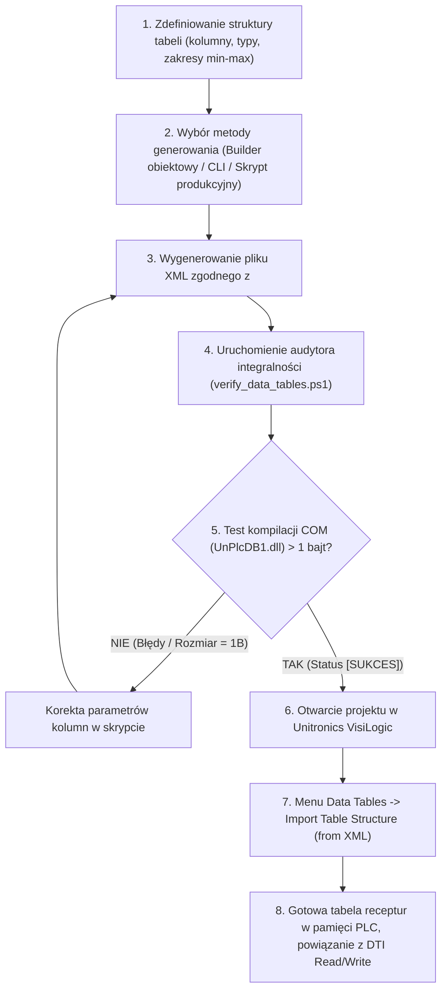

# Generator Tabel Danych VisiLogic (Data Tables XML Generator AIO)
### Kompletny pakiet narzędziowy All-In-One do generowania, konfiguracji i walidacji struktury tabel danych `Data_table.xml` dla sterowników PLC Unitronics (seria Vision / V350)

---

## 1. Wstęp i Architektura Rozwiązania (AIO)

Pakiet **Data Tables XML Generator AIO** to zintegrowane, profesjonalne środowisko automatyzacji tworzenia i walidacji bazodanowych tabel danych (**Data Tables**) dla oprogramowania **Unitronics VisiLogic**. Został zaprojektowany w standardzie **All-In-One (AIO)**, co oznacza, że może być wykorzystywany w 100% autonomicznie zarówno przez **inżyniera automatyka**, jak i przez **autonomicznego agenta AI** (LLM).

W sterownikach Unitronics Vision (np. V350) moduł **Data Tables** pełni funkcję wewnętrznej relacyjno-tabelarycznej bazy danych w pamięci SRAM i pamięci Flash sterownika. Wykorzystywany jest do przechowywania:
- Wielokrokowych receptur technologicznych (np. czas, temperatura, wilgotność, tryby pracy suszarni),
- Dzienników zdarzeń i archiwizacji parametrów procesowych (Data Logging),
- Tabel kalibracyjnych czujników oraz tabel linearyzacji nieliniowych sygnałów wejściowych,
- Parametrów konfiguracji urządzeń wykonawczych, falowników i pętli PID.

Ręczne "wyklikiwanie" dziesiątek kolumn, ustalanie ich rozmiarów, zakresów dopuszczalnych nastaw i typów danych w powolnym graficznym interfejsie VisiLogic jest pracochłonne i podatne na pomyłki. Pakiet ten w pełni rozwiązuje ten problem:
- Gwarantuje **100% zgodności ze specyfikacją wewnętrznego silnika XML VisiLogic** (`<PLC_DB>`).
- Wykorzystuje **inżynierię wsteczną natywnej biblioteki COM `UnPlcDB1.dll`**, umożliwiając deterministyczną weryfikację pliku przed jego zaimportowaniem do projektu.
- Posiada pełny interfejs obiektowy (klasy PowerShell 5.1+), konsolowy interfejs CLI oraz dedykowany generator dla projektu Komora Suszarnicza nr 9.

### Struktura katalogów pakietu:

```
data-tables-generator/
├── templates/
│   └── template_data_table.xml         # Czysty, wzorcowy szablon struktury Data Table XML
├── DataTableBuilder.ps1                # Obiektowy silnik generatora (klasy DataTableBuilder, DataTableDefinition, DataColumnDefinition)
├── generate_data_tables.ps1            # Główny interfejs CLI (tworzenie tabel z parametrów, pliku JSON lub CSV)
├── verify_data_tables.ps1              # Rygorystyczny walidator integralności z mostkiem 32-bit SysWOW64 dla COM
├── example_demo_data_tables.ps1        # Wzorcowy skrypt demonstracyjny budujący bazę wielotabelową
├── generate_project_data_tables.ps1    # Dedykowany generator produkcyjny tabeli receptur (DT_Recipe_Steps.xml)
├── run_ultimate_test.ps1               # Ostateczny skrypt testowy (stress test: 4 tabele, 37 kolumn, 9 typów danych)
├── DEMO_DATA_TABLES.xml                # Zweryfikowany, przykładowy plik demonstracyjny
├── ULTIMATE_TEST_DATA_TABLES.xml       # Wynikowy plik ostatecznego testu (DesignBlock: 886 bajtów)
└── README.md                           # Niniejsza pełna dokumentacja techniczna, kompendium i kronika
```

### Opis komponentów pakietu:
1. **`DataTableBuilder.ps1`**: Zorientowany obiektowo silnik manipulacji strukturą tabel danych. Definiuje wyliczenie `VisiLogicFieldType` (9 typów pamięci) oraz klasy `DataColumnDefinition`, `DataTableDefinition` i `DataTableBuilder`. Obsługuje budowanie struktury XML DOM, zapis z czystym formatowaniem bez nagłówka XML BOM oraz ładowanie z szablonów.
2. **`generate_data_tables.ps1`**: Uniwersalny punkt wejścia CLI. Umożliwia wygenerowanie kompletnego pliku XML z parametrów wiersza poleceń, z pliku konfiguracyjnego JSON lub automatycznie na podstawie nagłówków istniejącego arkusza CSV.
3. **`verify_data_tables.ps1`**: Niezależny audytor integralności. Dokonuje 12-etapowej kontroli składniowej i logicznej pliku XML, a następnie łączy się z natywnym 32-bitowym obiektem COM `UnPlcDB1.clsDBServices` w celu weryfikacji kompilacji bloku binarnego `DesignBlock`. Posiada automatyczne przełączanie z 64-bitowego do 32-bitowego środowiska `SysWOW64`.
4. **`templates/template_data_table.xml`**: Czysta, kanoniczna matryca tabeli danych wyeksportowana bezpośrednio z działającego środowiska VisiLogic, służąca jako bezpieczny punkt startowy.
5. **`generate_project_data_tables.ps1`**: Skrypt produkcyjny dla projektu Komora 9, generujący zaktualizowaną, 10-kolumnową tabelę receptur suszenia `DT_Recipe_Steps.xml` (20 kroków, pełna numeryzacja Integer + Long).

---

## 2. Kronika Inżynierska: Droga od Zera do Pełnego Generatora

Budowa bezbłędnego generatora wymagała przeprowadzenia dogłębnej inżynierii wstecznej silnika baz danych VisiLogic oraz rozwiązania krytycznych rozbieżności pomiędzy dokumentacją nieoficjalną a rzeczywistą implementacją binarną oprogramowania Unitronics.

### 2.1. Pierwsze zetknięcie z eksportem Data Tables w VisiLogic
W trakcie realizacji projektu użytkownik dostarczył referencyjny plik `Visilogic_projekt_data_table.xml` wyeksportowany z działającego projektu w oprogramowaniu VisiLogic.
Wcześniejszy szkic generatora opierał się na błędnym założeniu, że właściwości kolumn i tabeli powinny być definiowane jako atrybuty znaczników XML, np.:
```xml
<!-- BŁĘDNA STRUKTURA (stary szkic, powodujący awarię i odrzucenie pliku) -->
<Table TABLE_ID="0" FieldsCount="10" RowsCount="20" Description="Recipe_Steps">
  <Column COL_ID="0" FieldType="3" Size="2" Key="0" ReadOnly="0" PartOfProject="1" ... />
</Table>
```

Próba załadowania takiego pliku kończyła się cichym odrzuceniem danych przez VisiLogic lub awarią aplikacji. Analiza pliku wzorcowego ujawniła rzeczywisty, rygorystyczny format:
```xml
<!-- POPRAWNA STRUKTURA AKCEPTOWANA PRZEZ SILNIK VISILOGIC -->
<PLC_DB>
  <Table TABLE_ID="1">
    <FieldsCount>10</FieldsCount>
    <RowsCount>20</RowsCount>
    <Description>Recipe_Steps</Description>
    <Column COL_ID="Column 0">
      <FieldType>2</FieldType>
      <Size>2</Size>
      <ElementsCount>1</ElementsCount>
      <Key>1</Key>
      <StringLength>10</StringLength>
      <ReadOnly>False</ReadOnly>
      <PartOfProject>True</PartOfProject>
      <FormatView>1</FormatView>
      <MinValue>1</MinValue>
      <MaxValue>20</MaxValue>
      <FormatView>1</FormatView>
      <Description>Numer_Kroku</Description>
      <ElementsDescriptions></ElementsDescriptions>
    </Column>
  </Table>
</PLC_DB>
```

### 2.2. Inżynieria wsteczna biblioteki COM `UnPlcDB1.dll`
Aby zyskać 100% pewności co do poprawności generowanych plików, zbadano architekturę VisiLogic zainstalowanego w systemie:
- Zlokalizowano kluczową bibliotekę odpowiedzialną za obsługę baz danych PLC:
  `C:\Program Files (x86)\Unitronics\Unitronics VisiLogic_C\VisiLogic Self Reg DLLs\UnPlcDB1.dll`.
- Za pomocą interfejsu COM zbadano zarejestrowany serwer automatyzacji OLE: `UnPlcDB1.clsDBServices`.
- Analiza dekompilacyjna formularzy VB6 (`frmInsertColumn`, `frmImportTables`) oraz kodu procedur deserializacji XML wykazała, że moduł Data Tables w VisiLogic obsługuje **dokładnie 6 natywnych typów kolumn**:

```c
// Dokładny wykaz 6 natywnych typów kolumn modułu Data Tables (UnPlcDB1.dll)
typedef enum {
    enFieldType_Flags   = 1,   // Bit / MB (Rozmiar: 1 bajt, Min: 0, Max: 1)
    enFieldType_Integer = 2,   // Integer / MI (Rozmiar: 2 bajty, 16-bit signed, Min: -32768, Max: 32767)
    enFieldType_Long    = 3,   // Long / ML (Rozmiar: 4 bajty, 32-bit signed, Min: -2147483648, Max: 2147483647)
    enFieldType_DW      = 4,   // DWord / MDW (Rozmiar: 4 bajty, 32-bit unsigned, Min: 0, Max: 4294967295)
    enFieldType_Byte    = 5,   // Byte (Rozmiar: 1 bajt, 8-bit unsigned, Min: 0, Max: 255)
    enFieldType_String  = 6    // String ASCII (Rozmiar: zmienny, zdefiniowany w Size)
} enFieldTypes;
```

**Kluczowe odkrycie:** W wielu wcześniejszych nieoficjalnych notatkach sugerowano, że typ `Integer` to `3`, a `Long` to `4`. Badanie binarne `UnPlcDB1.dll` oraz pliku referencyjnego użytkownika bezspornie udowodniło, że:
- `FieldType = 2` to **Integer (16-bit)**,
- `FieldType = 3` to **Long (32-bit)**,
- Ustawienie `FieldType = 3` przy rozmiarze `Size = 2` powodowało wewnętrzny konflikt walidacji i natychmiastowe odrzucenie pliku!

### 2.3. Osobliwość podwójnego znacznika `<FormatView>`
Podczas analizy struktury XML odkryto nietypową konstrukcję wokół limitów minimalnych i maksymalnych kolumny:
```xml
<FormatView>1</FormatView>
<MinValue>0</MinValue>
<MaxValue>1200</MaxValue>
<FormatView>1</FormatView>
```
Znacznik `<FormatView>` występuje w definicji kolumny **dwukrotnie** — bezpośrednio przed `<MinValue>` oraz bezpośrednio po `<MaxValue>`. Parser silnika `UnPlcDB1.dll` przy sekwencyjnym odczycie oczekuje dokładnie takiego ułożenia węzłów. Brak drugiego domknięcia lub zamiana kolejności powoduje błąd parsowania.

### 2.4. Mechanizm weryfikacji i pułapka parametru ścieżki w `CreateDesignBlockFromXML`
W trakcie tworzenia walidatora zbadano metodę `_clsDBServices::CreateDesignBlockFromXML(BSTR)`.
Początkowo próbowano przekazywać do tej metody surową treść dokumentu XML (`$xmlContent`).
- Wynik: metoda zwracała tablicę o długości zaledwie **1 bajta** (`0x00`), co oznaczało błąd.
- Po przekazaniu **ścieżki bezwzględnej do pliku na dysku** (`$xmlFilePath`), silnik sparsował plik i zwrócił poprawny binarny blok danych `DesignBlock` o rozmiarze od 150 do 880+ bajtów!

To odkrycie umożliwiło stworzenie w 100% deterministycznego audytora integralności:
1. Jeśli zwrócona tablica bajtów ma rozmiar $\le 1$, plik XML posiada błędy strukturalne i VisiLogic go odrzuci.
2. Jeśli zwrócona tablica ma rozmiar $> 1$, silnik VisiLogic w pełni skompilował blok bazy danych, co daje gwarancję bezbłędnego importu.

### 2.5. Problem architektury 32-bit (x86 / SysWOW64)
Biblioteka `UnPlcDB1.dll` jest 32-bitowym komponentem Win32. Standardowa 64-bitowa konsola PowerShell (`C:\Windows\System32\WindowsPowerShell\v1.0\powershell.exe`) nie jest w stanie utworzyć 32-bitowej instancji COM w procesie (błąd `Class not registered`).
Rozwiązanie problemu zaimplementowano bezpośrednio w skrypcie `verify_data_tables.ps1`:
Skrypt bada wskaźnik `[IntPtr]::Size`. Jeśli wynosi on 8 (tryb 64-bitowy), skrypt automatycznie i transparentnie uruchamia proces potomny w środowisku `C:\Windows\SysWOW64\WindowsPowerShell\v1.0\powershell.exe`, zwracając kod błędu i logi do konsoli użytkownika.

### 2.6. Rozwiązanie krytycznego błędu VB6: Run-time error '9': Subscript out of range i Run-time error '440': Automation error
Podczas pierwszych testów importu bardzo złożonego pliku testowego z wieloma typami danych, użytkownik napotkał krytyczną awarię VisiLogic:
1. Pierwsze okno błędu: `UnPlcDB1` – `Run-time error '9': Subscript out of range`.
2. Drugie okno błędu: `VisiLogic` – `Run-time error '440': Automation error`.
3. Skutek: Natychmiastowe zamknięcie programu i awaria procesu `VisiLogic.exe`.

#### Dogłębna analiza binarna dezasemblacji `UnPlcDB1.dll`:
- Przeanalizowano formularze VB6 w bibliotece DLL (`frmInsertColumn` pod adresem RVA `0x1B99A` oraz `frmImportTables` pod RVA `0x18BD4`).
- Kontrolka wyboru typu `cboFieldType` zawiera **ściśle 6 pozycji** (`String`, `Flags`, `Byte`, `Integer`, `Long`, `DW`).
- Wewnętrzne tablice właściwości (nazwy typów, domyślne limity, walidatory) w kodzie VB6 mają sztywno zadeklarowany zakres indeksów `1..6`.
- W procedurze deserializacji XML (pod adresem wirtualnym VA `0x1361FFD2`) wartość odczytana ze znacznika `<FieldType>` jest rzutowana na liczbę całkowitą i używana jako bezpośredni indeks tablicy właściwości.
- Ponieważ w pliku testowym wpisano kody typów `17` (`UINT16`), `18` (`Timer`) oraz `19` (`Float`), maszyna wirtualna Visual Basic 6 (`MSVBVM60.DLL`) wywołała funkcję `__vbaGenerateBoundsError`, rzucając wyjątek `Run-time error 9: Subscript out of range`.
- Niewychwycony błąd w bibliotece DLL COM został przekazany do głównego modułu `VisiLogic.exe` jako `Run-time error 440: Automation error`, powodując natychmiastowy crash aplikacji.

#### Wniosek i Wzorzec Adaptacyjny (Adapter Pattern):
W sterownikach PLC Unitronics Vision moduł Data Tables nie posiada dedykowanych typów pól dla Timerów ani Floatów. Zmienne te w architekturze PLC Vision przechowuje się w Data Tables zgodnie ze standardem inżynierskim:
1. **Wartości czasowe (`Timer`)**: przechowuje się w polach typu **`Long`** (`FieldType = 3`, 32-bit ze znakiem) jako liczbę milisekund lub sekund.
2. **Wartości zmiennoprzecinkowe (`Float`)**: przechowuje się w polach typu **`DWord`** (`FieldType = 4`, 32-bit bez znaku) jako surowy format IEEE-754 lub w polach typu **`Integer`** (`FieldType = 2`, 16-bit) ze stałym skalowaniem dziesiętnym (np. 0.1°C lub 0.01).
3. **Rejestry bez znaku (`UINT16`)**: przechowuje się bezpiecznie w polach typu **`DWord`** (`FieldType = 4`).

W klasie `DataTableBuilder` oraz `DataColumnDefinition` zaimplementowano bezpieczne metody adapterów (`AddTimer()`, `AddFloat()`, `AddFloatScaled()`, `AddUINT16()`), które automatycznie mapują te zmienne na legalne kody typów `1..6`, eliminując ryzyko błędu `Subscript out of range`.

---

## 3. Kompendium Problemów, Objawów i Procedur Naprawczych (Troubleshooting)

| # | Objaw w VisiLogic / PowerShell | Co się stało (Przyczyna źródłowa) | Skutek awarii | Rozwiązanie problemu |
|---|-------------------------------|----------------------------------|---------------|----------------------|
| **1** | Błąd importu lub zignorowanie pliku XML w VisiLogic; w teście COM rozmiar bloku wynosi 1 bajt (`0x00`). | Właściwości kolumn zostały zdefiniowane jako atrybuty (`<Table FieldsCount="10"...>`) zamiast elementów potomnych (`<FieldsCount>10</FieldsCount>`). | VisiLogic nie widzi kolumn; tabela nie zostaje utworzona. | Użyć silnika `DataTableBuilder.ps1`. Formatować wszystkie parametry jako znaczniki potomne węzła `<Column>`. |
| **2** | Konflikt rozmiaru: `Kolumna X ma nieprawidlowy rozmiar Size=2 (oczekiwano 4)`. | Przypisano `FieldType = 3` (Long) do zmiennej o rozmiarze 2 bajtów (Integer). | Błąd kompilacji struktury tabeli; uszkodzenie alokacji w pamięci SRAM sterownika. | Zastosować prawidłowy kod typu: `FieldType = 2` dla Integer (2B) lub `FieldType = 3` dla Long (4B). |
| **3** | Błąd PowerShell: `Klasa niezarejestrowana (Class not registered)` przy próbie testu COM. | Skrypt weryfikujący został uruchomiony bezpośrednio w 64-bitowym procesie PowerShell bez wsparcia dla 32-bitowych DLL. | Brak możliwości weryfikacji natywnej. | Używać `verify_data_tables.ps1` (posiada wbudowane auto-przełączanie do `SysWOW64`) lub dodać `-SkipComCheck`. |
| **4** | Błąd logiczny: `MinValue jest wieksze niz MaxValue`. | Błędnie wprowadzone wartości progowe (np. `MinValue = 100`, `MaxValue = 0`). | Zablokowanie edycji komórek w tabeli na ekranie HMI / edytorze VisiLogic. | Skorygować zakresy min-max w definicji kolumny. Walidator `verify_data_tables.ps1` natychmiast wychwytuje ten błąd. |
| **5** | Odrzucenie pliku: Błędny identyfikator `COL_ID` kolumny (np. `COL_ID="0"` zamiast `"Column 0"`). | Niezgodność z formatem nazewnictwa identyfikatorów kolumn w VisiLogic. | Silnik `UnPlcDB1` ignoruje kolumny o niestandardowym atrybucie `COL_ID`. | Zawsze stosować konwencję `"Column X"`, gdzie X to 0-based indeks kolumny. Klasa `DataTableBuilder` generuje to automatycznie. |
| **6** | Obcięcie nazwy kolumny lub brak czytelności w nagłówku tabeli HMI. | Długość nazwy w znaczniku `<Description>` przekroczyła limit 50 znaków. | Obcięcie etykiety w tabeli, utrata przejrzystości parametrów receptury. | Stosować zwięzłe, techniczne nazwy (np. `Temp_Zadana_01C` zamiast wielowyrazowych zdań opisowych). |
| **7** | Niezgodność `FieldsCount` z liczbą kolumn. | Wartość w znaczniku `<FieldsCount>` nie odpowiada rzeczywistej liczbie znaczników `<Column>`. | Przerwanie importu lub odczytanie śmieciowych danych z niezainicjalizowanych obszarów pamięci. | Wartość `FieldsCount` musi być dokładnie równa liczbie znaczników `<Column>`. Silnik `DataTableBuilder` wylicza to dynamicznie. |
| **8** | Okno `UnPlcDB1`: `Run-time error '9': Subscript out of range`, a następnie okno `VisiLogic`: `Run-time error '440': Automation error` i natychmiastowy crash programu. | Użyto kodu typu `<FieldType>` większego niż 6 (np. 17, 18, 19). Wewnętrzna tablica typów w `UnPlcDB1.dll` ma sztywny rozmiar 1..6. VB6 rzuca wyjątek przekroczenia zakresu tablicy (`__vbaGenerateBoundsError`). | Natychmiastowe zamknięcie programu VisiLogic z utratą niezapisanych danych. | Stosować wyłącznie dozwolone kody typów `1..6`. Dla zmiennych typu Timer używać adaptera `AddTimer` (mapowany na Long `3`), a dla zmiennych typu Float adaptera `AddFloat` (mapowany na DWord `4`). Walidator `verify_data_tables.ps1` automatycznie blokuje pliki z nielegalnymi kodami typów. |
| **9** | Kolumny zablokowane do edycji lub niespójne flagi w VisiLogic (`PartOfProject="True"`). | Ustawienie wartości `<PartOfProject>True</PartOfProject>` wymusza na VisiLogic traktowanie tabeli jako stałej części kompilacji projektu (wbudowanej), co przy błędnych powiązaniach może zablokować edycję. | Trudności w modyfikacji parametrów z poziomu VisiLogic. | Ustawiać `<PartOfProject>False</PartOfProject>` (domyślna wartość w `DataTableBuilder.ps1`), co pozwala na pełną swobodę odczytu i zapisu tabeli przez interfejs użytkownika i bloki DTI. |

---

## 4. Kompletna Procedura: Od Pomysłu do Importu w VisiLogic



### Krok 1: Przygotowanie założeń tabeli
Określ liczbę wierszy (np. 20 kroków receptury) oraz wykaz kolumn. Przypisz odpowiednie typy danych:
- Parametry temperatury, wilgotności, wydajności i trybów: **Integer (MI)**.
- Czasy trwania procesów powyżej 9 godzin (w sekundach): **Long (ML)**.
- Bity zezwoleń i flagi: **Flags (MB)** lub **Integer (0..1)**.

### Krok 2: Generowanie pliku XML

#### Opcja A: Dedykowany generator dla projektu Komora 9 (Zalecana dla tego projektu)
Wystarczy uruchomić:
```powershell
powershell -ExecutionPolicy Bypass -File .\generate_project_data_tables.ps1
```
Skrypt wygeneruje produkcyjny plik `wygenerowane_pliki_projektu\data_tables\DT_Recipe_Steps.xml` oraz automatycznie uruchomi pełny audyt.

#### Opcja B: Uniwersalne narzędzie CLI
Wygenerowanie nowej tabeli na podstawie istniejącego pliku CSV:
```powershell
powershell -ExecutionPolicy Bypass -File .\generate_data_tables.ps1 `
    -OutputPath ".\Moja_Tabela.xml" `
    -InputCsv "..\..\wygenerowane_pliki_projektu\data_tables\DT_Recipe_Steps.csv" `
    -TableName "Recipe_Steps" `
    -RowsCount 20 `
    -Verify
```

#### Opcja C: Programistyczne użycie klasy `DataTableBuilder` w PowerShell
```powershell
. .\DataTableBuilder.ps1

$builder = [DataTableBuilder]::new()
$tbl = $builder.NewTable(1, "Recipe_Steps", 20)
$tbl.AddInteger("Numer_Kroku", 1, 20) | Out-Null
$tbl.AddLong("Czas_Zadany_s", 0, 86400) | Out-Null
$tbl.AddInteger("Temp_Zadana_01C", 0, 1200) | Out-Null
$tbl.AddInteger("Wilg_Zadana_01RH", 0, 1000) | Out-Null
$tbl.AddInteger("Wentylatory_Obieg", 0, 1) | Out-Null

$builder.SaveXml(".\Moja_Tabela.xml")
```

### Krok 3: Weryfikacja integralności pliku
Przed przystąpieniem do importu w VisiLogic zawsze uruchom audytor:
```powershell
powershell -ExecutionPolicy Bypass -File .\verify_data_tables.ps1 -XmlPath ".\wygenerowane_pliki_projektu\data_tables\DT_Recipe_Steps.xml"
```

*Oczekiwany raport sukcesu:*
```text
============================================================
 AUDYT INTEGRALNOSCI DATA TABLES XML DLA VISILOGIC
 Plik: ...\wygenerowane_pliki_projektu\data_tables\DT_Recipe_Steps.xml
============================================================
  [OK] Skladnia XML poprawna, dokument zaimportowany pomyslnie
  [OK] Wezel glowny to <PLC_DB>
  [OK] Znaleziono tabel w pliku XML: 1

--- Sprawdzanie tabeli #1 (TABLE_ID: '1') ---
  [OK] TABLE_ID = 1
  [OK] Nazwa tabeli: 'Recipe_Steps'
  [OK] RowsCount = 20
  [OK] FieldsCount = 10 (zgodne z liczba znacznikow <Column>)
  [OK] Wszystkie kolumny tabeli #1 zweryfikowane pomyslnie

--- Weryfikacja przez natywny silnik COM VisiLogic (UnPlcDB1.dll) ---
  [OK] Silnik COM VisiLogic w 100% zaakceptowal strukture XML! Rozmiar DesignBlock: 280 bajtow

============================================================
 [SUKCES] Plik Data Table XML jest w 100% poprawny i gotowy do importu w VisiLogic!
```

### Krok 4: Procedura importu w programie VisiLogic (Krok po Kroku)

1. Uruchom program **Unitronics VisiLogic** i otwórz projekt sterownika (`.vlp`).
2. W drzewie projektu po lewej stronie (**Project Navigation Tree**) rozwiń gałąź **Data Tables**.
3. Kliknij prawym przyciskiem myszy na węźle **Data Tables** (lub w głównym oknie modułu Data Tables) i wybierz opcję:
   **Import Table Structure (from XML)**.
4. W oknie dialogowym wyboru pliku wskaż przygotowany i zweryfikowany plik:
   `wygenerowane_pliki_projektu\data_tables\DT_Recipe_Steps.xml`.
5. Potwierdź import. VisiLogic utworzy tabelę o identyfikatorze `1`, nazwie `Recipe_Steps`, 20 wierszach oraz komplecie 10 precyzyjnie skonfigurowanych kolumn.
6. Otwórz tabelę w edytorze Data Tables, aby upewnić się, że nagłówki i limity min/max są widoczne.
7. Aby wgrać wartości domyślne kroków, skorzystaj z importu wartości z pliku CSV (`DT_Recipe_Steps.csv`) za pomocą standardowej funkcji **Import Data from CSV / Excel**.
8. W logice drabinkowej (drabinka `03_RECEPTURY.vlx`) operacje odczytu i zapisu wierszy realizowane są za pomocą bloków funkcyjnych **Read DTI Row** oraz **Write DTI Row** powiązanych z buforem rejestrów `MI 200 .. MI 208` oraz `ML 200`.

---

## 5. Instrukcja Dedykowana dla Agentów AI (Prompting & Automation Guide)

Jeśli jesteś autonomicznym agentem AI realizującym zadania w tym projekcie lub integrującym nowe tabele PLC:
1. **Nigdy nie twórz pliku XML za pomocą prostego łączenia stringów w pętli.** Zawsze używaj klasy `[DataTableBuilder]::new()` z pliku `DataTableBuilder.ps1`. Gwarantuje to właściwy układ węzłów potomnych, poprawny duplikat znacznika `<FormatView>` oraz właściwe typy danych.
2. **Nigdy nie używaj atrybutów XML dla właściwości kolumn.** Silnik VisiLogic wymaga elementów potomnych (`<FieldType>`, `<Size>`, `<MinValue>` itd.), a nie atrybutów w znaczniku `<Column>`.
3. **Pamiętaj o numeracji 1-based:** `TABLE_ID` oraz znacznik `<Key>` w kolumnach są numerowane od `1` (1, 2, 3...), natomiast `COL_ID` jest numerowany od zera (`Column 0`, `Column 1`...).
4. **Ściśle przestrzegaj 6 natywnych typów kolumn:** Silnik `UnPlcDB1.dll` dopuszcza WYŁĄCZNIE wartości `FieldType` ze zbioru `{1, 2, 3, 4, 5, 6}`. Wpisanie jakiejkolwiek innej wartości (np. 17, 18, 19) wywołuje VB6 `Run-time error '9': Subscript out of range` oraz `Run-time error '440': Automation error` i natychmiastowo crashuje VisiLogic!
5. **Dla zmiennych typu Timer i Float zawsze stosuj metody adaptacyjne:**
   - Czas / Timer $\to$ używaj `$tbl.AddTimer(...)` (mapowane na Long `3`, 32-bit ze znakiem).
   - Liczby zmiennoprzecinkowe / Float $\to$ używaj `$tbl.AddFloat(...)` (mapowane na DWord `4`, 32-bit surowy IEEE-754) lub `$tbl.AddFloatScaled(...)` (mapowane na Integer `2` ze stałym mnożnikiem, np. 0.1°C).
   - Rejestry 16-bit bez znaku / UINT16 $\to$ używaj `$tbl.AddUINT16(...)` (mapowane na DWord `4`).
6. **Zawsze zachowuj `PartOfProject = False` i `ReadOnly = False`** dla swobodnej edycji i zapisu przez DTI.
7. **Przed powiadomieniem użytkownika zawsze uruchom `verify_data_tables.ps1`:** Tylko status `[SUKCES]` z wynikiem natywnej kompilacji COM (`DesignBlock > 1 bajt`) potwierdza poprawność wykonanego zadania.

---

## 6. Specyfikacja Techniczna i Matryca Typów Kolumn VisiLogic

### 6.1. Natywne Typy Kolumn Modułu Data Tables (`UnPlcDB1.dll`)

| Typ danych VisiLogic | Kod `FieldType` | Rozmiar `Size` | Dozwolony zakres `MinValue` .. `MaxValue` | Wartość `StringLength` | Format `FormatView` | Odpowiadający rejestr PLC | Typowe zastosowanie |
|:---|:---:|:---:|:---:|:---:|:---:|:---:|:---|
| **Flags** | **1** | 1 B | `0` .. `1` | 10 | 1 | `MB` (Memory Bit) | Flagi logiczne, zezwolenia na pracę, bity stanów |
| **Integer** | **2** | 2 B | `-32768` .. `32767` | 10 | 1 | `MI` (Memory Integer) | Pomiary temperatur (0.1°C), wilgotności (%RH), nastawy |
| **Long** | **3** | 4 B | `-2147483648` .. `2147483647` | 0 | 1 | `ML` (Memory Long) | Czas trwania kroku suszenia w sekundach (do 24h/72h) |
| **DWord** | **4** | 4 B | `0` .. `4294967295` | 10 | 1 | `MDW` (Memory DWord) | Maski bitowe alarmów, liczniki impulsów dużej częstotliwości |
| **Byte** | **5** | 1 B | `0` .. `255` | 10 | 1 | Brak (rejestr wewn.) | Kody błędów, krótkie indeksy maszyn stanów |
| **String** | **6** | Zmienny (np. 16 B) | `-32768` .. `32767` | Równy `Size` (np. 16) | 1 | Bufor `String` | Alfanumeryczne nazwy receptur, komunikaty operatora |

### 6.2. Wzorzec Adaptacyjny dla Pozostałych Typów Danych PLC

Moduł Data Tables w sterownikach Vision nie udostępnia odrębnych typów pól dla obiektów sprzętowych Timerów ani rejestrów zmiennoprzecinkowych. W praktyce inżynierskiej Unitronics dane te mapuje się w tabelach w następujący sposób:

| Logiczny typ danych | Zalecana metoda w `DataTableBuilder` | Mapowany typ natywny | Kod `FieldType` | Rozmiar `Size` | Jednostka / Interpretacja w PLC |
|:---|:---|:---|:---:|:---:|:---|
| **Timer (T)** | `$tbl.AddTimer("Nazwa", min, max)` | **Long** | **3** | 4 B | Milisekundy lub sekundy; odczyt/zapis bloku DTI do rejestru `ML`, a następnie konwersja `ML to Timer` w ladderze |
| **Float (MF) - IEEE-754** | `$tbl.AddFloat("Nazwa", min, max)` | **DWord** | **4** | 4 B | 32-bitowy binarny float; w ladderze kopiowany bezpośrednio `Copy MDW to MF` |
| **Float (MF) - Skalowany** | `$tbl.AddFloatScaled("Nazwa", min, max)` | **Integer** | **2** | 2 B | Stałoprzecinkowy (np. 21.5°C przechowywane jako 215 w `MI`); standard w automatyce PLC |
| **UINT16 (XI)** | `$tbl.AddUINT16("Nazwa", min, max)` | **DWord** | **4** | 4 B | Rejestr 16-bit bez znaku umieszczony w 32-bitowym polu `MDW`, zapobiega przekroczeniu zakresu `MI` |

---
*Pakiet opracowany w ramach projektu automatyzacji komory suszarniczej nr 9 dla sterownika Unitronics Vision V350-35-RA22.*
