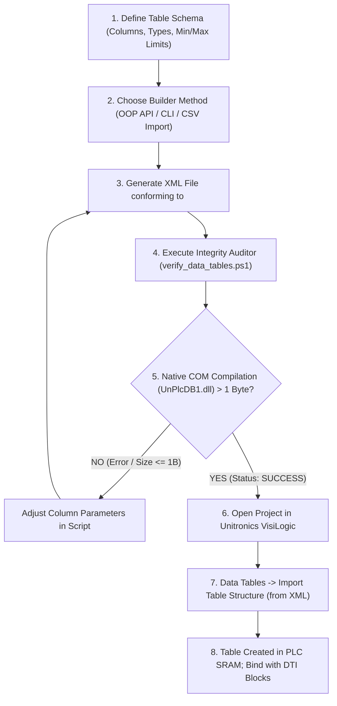

# VisiLogic Data Tables Generator (Data Tables XML Generator AIO)
### Complete All-In-One Toolkit for Generating, Configuring, and Validating `Data_table.xml` Structures for Unitronics Vision Series PLCs (V130, V350, V570, V1040, V1210)

---

## 1. Introduction and Architecture (AIO)

The **Data Tables XML Generator AIO** is an integrated automation framework for programmatically building and validating tabular databases (**Data Tables**) for **Unitronics VisiLogic**. Designed according to the **All-In-One (AIO)** standard, it functions autonomously for both **control systems engineers** and **autonomous AI agents**.

In Unitronics Vision controllers, the **Data Tables** module functions as an embedded relational database allocated within PLC SRAM and Flash memory. Typical industrial applications include:
- Multi-step process recipes (step times, target temperatures, speed references, cycle modes),
- Shift production logging and OEE tracking,
- High-resolution alarm audit trails and timestamped fault logs,
- Sensor linearization tables and multi-point calibration curves,
- PID loop tuning parameters and drive configuration registers.

Manually entering dozens of columns, configuring field types, setting boundary limits, and adjusting display widths through the VisiLogic GUI is time-consuming and prone to human error. This toolkit completely automates that workflow:
- Guarantees **100% compliance with the internal VisiLogic XML specification** (`<PLC_DB>`).
- Leverages **reverse-engineering of the native 32-bit COM library `UnPlcDB1.dll`** to deterministically verify files prior to importing into VisiLogic.
- Provides an object-oriented PowerShell API (`DataTableBuilder.ps1`), a versatile CLI interface (`generate_data_tables.ps1`), and pre-verified industrial templates.

### Package Directory Layout:

```text
data-tables-generator/
├── templates/
│   └── template_data_table.xml         # Canonical, clean Data Table XML schema template
├── DataTableBuilder.ps1                # OOP generator engine (classes DataTableBuilder, DataTableDefinition, DataColumnDefinition)
├── generate_data_tables.ps1            # CLI interface (generates tables from CLI params, JSON, or CSV headers)
├── verify_data_tables.ps1              # Strict 12-stage validator with automated 32-bit SysWOW64 COM bridge
└── README.md                           # Technical manual, reverse engineering chronicle, and API reference

# Application examples and production suites are located in:
# examples/data-tables/ (Chemical Batch Recipes, Shift Production Logs, Alarm Audit Trails)
```

### Core Components:
1. **`DataTableBuilder.ps1`**: The OOP core engine. Defines the `VisiLogicFieldType` enum (covering 6 native types and 3 adapter types) and manages the DOM hierarchy, clean formatting without XML BOM, and template cloning.
2. **`generate_data_tables.ps1`**: Universal CLI entry point. Supports building tables from command-line arguments, JSON schema files, or CSV headers with automatic type inference.
3. **`verify_data_tables.ps1`**: Automated integrity auditor. Performs a 12-stage structural and relational validation of the XML file, then connects to the native 32-bit COM object `UnPlcDB1.clsDBServices` to verify binary `DesignBlock` compilation.
4. **`templates/template_data_table.xml`**: Baseline reference template exported directly from VisiLogic.

---

## 2. Engineering Chronicle: Reverse Engineering the VisiLogic Database Engine

Developing an automated generator required in-depth reverse engineering of the VisiLogic database engine to resolve undocumented behaviors and critical disparities between unofficial community documentation and the actual binary implementation.

### 2.1. Anatomy of VisiLogic `<PLC_DB>` XML Files
Initial attempts to generate Data Tables often fail because developers assume XML attributes are used for properties:
```xml
<!-- INCORRECT SCHEMA (Causes silent rejection or crash in VisiLogic) -->
<Table TABLE_ID="0" FieldsCount="10" RowsCount="20" Description="Recipe_Steps">
  <Column COL_ID="0" FieldType="3" Size="2" Key="0" ReadOnly="0" PartOfProject="1" ... />
</Table>
```
Binary inspection of native exports revealed that VisiLogic's parser requires child elements inside `<Column>`:
```xml
<!-- VALID VISILOGIC XML SCHEMA -->
<PLC_DB>
  <Table TABLE_ID="1">
    <FieldsCount>10</FieldsCount>
    <RowsCount>20</RowsCount>
    <Description>Recipe_Steps</Description>
    <Column COL_ID="Column 0">
      <FieldType>2</FieldType>
      <Size>2</Size>
      <ElementsCount>1</ElementsCount>
      <Key>1</Key>
      <StringLength>10</StringLength>
      <ReadOnly>False</ReadOnly>
      <PartOfProject>False</PartOfProject>
      <FormatView>1</FormatView>
      <MinValue>1</MinValue>
      <MaxValue>20</MaxValue>
      <FormatView>1</FormatView>
      <Description>Step_Number</Description>
      <ElementsDescriptions></ElementsDescriptions>
    </Column>
  </Table>
</PLC_DB>
```

### 2.2. Reverse Engineering `UnPlcDB1.dll`
To achieve 100% deterministic generation, we analyzed the native library responsible for PLC database management:
- Location: `C:\Program Files (x86)\Unitronics\Unitronics VisiLogic_C\VisiLogic Self Reg DLLs\UnPlcDB1.dll`.
- Registered OLE Automation Server: `UnPlcDB1.clsDBServices`.
- Disassembly of VB6 forms (`frmInsertColumn` at RVA `0x1B99A`, `frmImportTables` at RVA `0x18BD4`) proved that VisiLogic supports **strictly 6 native column types**:

```c
typedef enum {
    enFieldType_Flags   = 1,   // Bit / MB (Size: 1 byte, Min: 0, Max: 1)
    enFieldType_Integer = 2,   // Integer / MI (Size: 2 bytes, 16-bit signed, Min: -32768, Max: 32767)
    enFieldType_Long    = 3,   // Long / ML (Size: 4 bytes, 32-bit signed, Min: -2147483648, Max: 2147483647)
    enFieldType_DW      = 4,   // DWord / MDW (Size: 4 bytes, 32-bit unsigned, Min: 0, Max: 4294967295)
    enFieldType_Byte    = 5,   // Byte (Size: 1 byte, 8-bit unsigned, Min: 0, Max: 255)
    enFieldType_String  = 6    // String ASCII (Size: user-defined, 1..50 bytes)
} enFieldTypes;
```

**Critical Discovery**: Prior community notes often asserted that `Integer` was type 3 and `Long` was type 4. Binary inspection proved unequivocally:
- `FieldType = 2` is **Integer (16-bit, Size = 2)**,
- `FieldType = 3` is **Long (32-bit, Size = 4)**.
Specifying `FieldType = 3` with `Size = 2` creates an internal size-mismatch exception that rejects the file.

### 2.3. The Duplicate `<FormatView>` Tag Quirk
Inside `<Column>`, the `<FormatView>` tag appears **twice**:
```xml
<FormatView>1</FormatView>
<MinValue>0</MinValue>
<MaxValue>1200</MaxValue>
<FormatView>1</FormatView>
```
The sequential XML stream reader in `UnPlcDB1.dll` explicitly expects this exact tag order. Omitting the duplicate closing tag or reordering nodes produces parsing errors.

### 2.4. Verification Engine via `CreateDesignBlockFromXML`
The COM method `_clsDBServices::CreateDesignBlockFromXML(BSTR)` compiles the XML table structure into the binary SRAM layout for the PLC.
- Passing raw XML string content returns a 1-byte error array (`0x00`).
- Passing the **absolute file path** (`$xmlFilePath`) instructs the engine to parse the file and return the compiled binary `DesignBlock` array (typically 150 to 880+ bytes).
This allows automated pre-import testing:
1. `ByteCount <= 1`: Compilation failed due to schema or range violations.
2. `ByteCount > 1`: VisiLogic compiled the database cleanly; guaranteed error-free import.

### 2.5. 32-Bit Execution Bridge (SysWOW64)
Because `UnPlcDB1.dll` is a 32-bit COM library, executing under a standard 64-bit PowerShell process fails with `Class not registered`. The `verify_data_tables.ps1` script inspects `[IntPtr]::Size`; if running in 64-bit mode (`Size == 8`), it automatically relaunches under `C:\Windows\SysWOW64\WindowsPowerShell\v1.0\powershell.exe`.

### 2.6. Resolving VB6 `Subscript out of range` (Error 9) and `Automation error` (Error 440)
Attempting to define columns with type IDs higher than 6 (e.g., 17 for UINT16, 18 for Timer, 19 for Float) triggers:
1. `UnPlcDB1` – `Run-time error '9': Subscript out of range`.
2. `VisiLogic` – `Run-time error '440': Automation error`.
3. Process crash of `VisiLogic.exe`.

**Root Cause**: The internal property arrays in VB6 (`MSVBVM60.DLL`) are hard-coded to bounds `1..6`. Indexing beyond 6 calls `__vbaGenerateBoundsError`.

**The Adapter Pattern**:
In Unitronics Vision controllers, hardware Timers and Floats are handled in Data Tables through standard PLC data representations:
1. **Timers (`Timer`)**: Stored in **`Long`** columns (`FieldType = 3`, 32-bit signed) as milliseconds or seconds.
2. **Floats (`Float`)**: Stored in **`DWord`** columns (`FieldType = 4`, raw 32-bit IEEE-754) or **`Integer`** columns (`FieldType = 2`) with decimal scaling (e.g. 0.1 °C).
3. **Unsigned Integers (`UINT16`)**: Stored in **`DWord`** columns (`FieldType = 4`) to avoid negative signed overflow.

The `DataTableBuilder` class provides high-level helper methods (`AddTimer()`, `AddFloat()`, `AddFloatScaled()`, `AddUINT16()`) that map cleanly to valid native types `1..6`.

---

## 3. Troubleshooting & Diagnostics Reference

| # | Symptom | Root Cause | Consequence | Resolution |
|:---:|:---|:---|:---|:---|
| **1** | Import fails silently; COM returns 1 byte (`0x00`). | Table properties defined as XML attributes instead of child tags. | VisiLogic ignores columns; table is not created. | Use `DataTableBuilder.ps1` to emit valid child tags. |
| **2** | Size mismatch: `Column X has invalid size Size=2 (expected 4)`. | Assigned `FieldType = 3` (Long) to a 2-byte field. | SRAM allocation corrupted. | Ensure `FieldType = 2` for 2-byte Integers, `3` for 4-byte Longs. |
| **3** | `Class not registered` in PowerShell during COM test. | Running in 64-bit PowerShell; COM DLL is 32-bit. | COM verification cannot execute. | Use `verify_data_tables.ps1` (auto-switches to `SysWOW64`) or `-SkipComCheck`. |
| **4** | `MinValue is greater than MaxValue`. | Inverted boundary limits (e.g. Min = 100, Max = 0). | HMI keypad and DTI write blocks reject entries. | Correct min/max values; `verify_data_tables.ps1` catches this immediately. |
| **5** | Column ignored: Invalid `COL_ID` (e.g. `COL_ID="0"`). | Naming convention violation. | `UnPlcDB1` skips non-conforming columns. | Always use `COL_ID="Column X"` where X is the 0-based column index. |
| **6** | Column name truncated on HMI display. | Description exceeds 50 characters. | Label clipped on operator screen. | Use concise engineering names (e.g. `Target_Temp_01C`). |
| **7** | Mismatched `FieldsCount`. | Tag count does not match `<Column>` count. | Corrupt memory read during PLC scan. | Let `DataTableBuilder` calculate `FieldsCount` automatically. |
| **8** | Crash: VB6 Error 9 (`Subscript out of range`) & Error 440. | Used `FieldType > 6` (e.g. 17, 18, 19). | VisiLogic crashes immediately. | Use only types 1..6 or the adapter methods (`AddTimer`, `AddFloat`). |
| **9** | Table locked from editing (`PartOfProject="True"`). | Table marked as immutable project code. | DTI blocks cannot write dynamic data. | Always keep `PartOfProject = False` and `ReadOnly = False`. |

---

## 4. Step-by-Step Generation and Import Procedure



### Step 1: Programmatic Generation via PowerShell OOP API
```powershell
. .\DataTableBuilder.ps1

$builder = [DataTableBuilder]::new()
$tbl = $builder.NewTable(1, "Recipe_Parameters", 24)
$tbl.AddInteger("Step_Index", 1, 24) | Out-Null
$tbl.AddTimer("Duration_Sec", 0, 86400) | Out-Null
$tbl.AddFloatScaled("Target_Temp_01C", 0, 1200) | Out-Null
$tbl.AddInteger("Target_Humidity_01RH", 0, 1000) | Out-Null
$tbl.AddFlags("Recirculation_Fan", 0, 1) | Out-Null

$builder.SaveXml(".\My_Data_Table.xml")
```

### Step 2: Verification with the Automated Auditor
```powershell
powershell -ExecutionPolicy Bypass -File .\verify_data_tables.ps1 -XmlPath ".\My_Data_Table.xml"
```

*Expected Verification Output:*
```text
============================================================
 VISILOGIC DATA TABLES XML INTEGRITY AUDIT
 File: ...\My_Data_Table.xml
============================================================
  [OK] Valid XML syntax; document loaded successfully
  [OK] Root node is <PLC_DB>
  [OK] Tables found in XML: 1

--- Validating Table #1 (TABLE_ID: '1') ---
  [OK] TABLE_ID = 1
  [OK] Table Description: 'Recipe_Parameters'
  [OK] RowsCount = 24
  [OK] FieldsCount = 5 (matches <Column> element count)
  [OK] All columns in Table #1 passed structural validation

--- Native VisiLogic COM Engine Verification (UnPlcDB1.dll) ---
  [OK] COM engine accepted XML structure! DesignBlock size: 264 bytes

============================================================
 [SUCCESS] Data Table XML is 100% valid and ready for VisiLogic import!
```

### Step 3: Importing into VisiLogic
1. Launch **Unitronics VisiLogic** and open your PLC project (`.vlp`).
2. In the left navigation pane (**Project Navigation Tree**), expand **Data Tables**.
3. Right-click on **Data Tables** and select **Import Table Structure (from XML)**.
4. Select the verified `.xml` file.
5. VisiLogic creates the table with all column headers, field types, and min/max limits configured.

---

## 5. Guidelines for AI Agents (Prompting & Automation Rules)

When developing or integrating Data Tables via autonomous agents:
1. **Never generate XML using raw string concatenation.** Always instantiate `[DataTableBuilder]::new()`. This prevents tag order issues and missing `<FormatView>` duplicates.
2. **Never use XML attributes for column properties.** Child tags (`<FieldType>`, `<Size>`, `<MinValue>`) are mandatory.
3. **Follow 1-based and 0-based numbering rules:**
   - `TABLE_ID` and the `<Key>` tag inside `<Column>` are 1-based (`1, 2, 3...`).
   - `COL_ID` attributes are 0-based (`"Column 0"`, `"Column 1"`...).
4. **Enforce native types 1 through 6:** Never set `FieldType` above 6. Use the adapter methods (`AddTimer`, `AddFloat`, `AddFloatScaled`, `AddUINT16`).
5. **Always execute `verify_data_tables.ps1` before reporting completion.** A positive test requires `DesignBlock > 1 byte`.

---

## 6. Technical Specifications & Column Types Matrix

### 6.1. Native Column Types (`UnPlcDB1.dll`)

| Data Type | `FieldType` | `Size` | Allowed Limits (`MinValue` .. `MaxValue`) | `StringLength` | `FormatView` | PLC Operand | Typical Application |
|:---|:---:|:---:|:---:|:---:|:---:|:---:|:---|
| **Flags** | **1** | 1 B | `0` .. `1` | 10 | 1 | `MB` (Memory Bit) | Logic flags, step interlocks, enable bits |
| **Integer** | **2** | 2 B | `-32768` .. `32767` | 10 | 1 | `MI` (Memory Integer) | Analog measurements (0.1 °C, %RH), setpoints |
| **Long** | **3** | 4 B | `-2147483648` .. `2147483647` | 0 | 1 | `ML` (Memory Long) | Extended step timers, high-capacity batch counters |
| **DWord** | **4** | 4 B | `0` .. `4294967295` | 10 | 1 | `MDW` (Memory DWord) | Alarm bitmasks, high-speed pulse registers |
| **Byte** | **5** | 1 B | `0` .. `255` | 10 | 1 | None (Internal) | State machine step codes, error classifications |
| **String** | **6** | Variable (e.g. 16 B) | `-32768` .. `32767` | Equal to `Size` (e.g. 16) | 1 | String Buffer | Product batch codes, alphanumeric recipe tags |

### 6.2. Adapter Mappings for Extended PLC Types

| Logical Data Type | Recommended `DataTableBuilder` Method | Underlying Native Type | `FieldType` | `Size` | Units / PLC Interpretation |
|:---|:---|:---|:---:|:---:|:---|
| **Timer (T)** | `$tbl.AddTimer("Name", min, max)` | **Long** | **3** | 4 B | Milliseconds or seconds; DTI Read/Write binds to `ML`, converted with ladder `ML to Timer` |
| **Float (MF) - IEEE-754** | `$tbl.AddFloat("Name", min, max)` | **DWord** | **4** | 4 B | 32-bit binary float; converted with ladder `Copy MDW to MF` |
| **Float (MF) - Scaled** | `$tbl.AddFloatScaled("Name", min, max)` | **Integer** | **2** | 2 B | Fixed-point integer (e.g., 21.5 °C represented as 215 in `MI`) |
| **UINT16 (XI)** | `$tbl.AddUINT16("Name", min, max)` | **DWord** | **4** | 4 B | Unsigned 16-bit register inside 32-bit `MDW` field |
