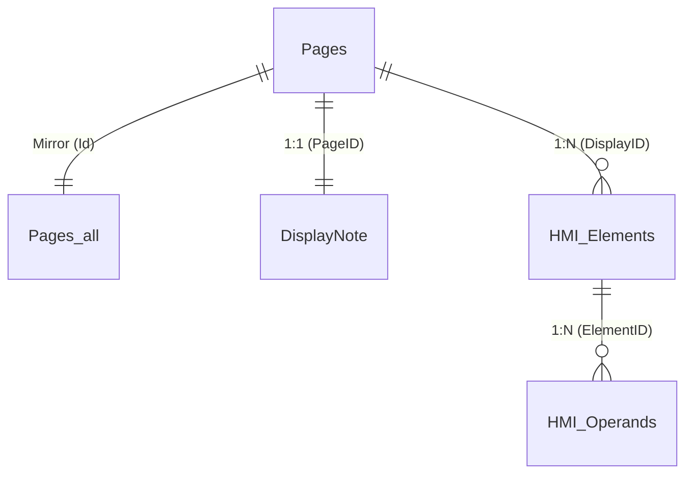

# Generator Ekranów HMI VisiLogic (.VLD) - Moduł All-In-One (AIO)
## Standard ANSI/ISA-101.01 | Projekt: Czysto Elektryczna Komora Suszarnicza nr 9

Profesjonalny silnik programistyczny do automatycznego projektowania, budowania i eksportu kompletnych ekranów operatorskich HMI w formacie `.vld` (VisiLogic Displays) dla sterowników PLC serii **Unitronics Vision** (ze szczególnym uwzględnieniem modelu **Vision V350-35-RA22** o rozdzielczości 320x240 pikseli).

---

## Spis treści
1. [Wprowadzenie i architektura rozwiązania](#1-wprowadzenie-i-architektura-rozwiązania)
2. [Droga inżynierii wstecznej: Od analizy pliku do pełnego generatora](#2-droga-inżynierii-wstecznej-od-analizy-pliku-do-pełnego-generatora)
3. [Struktura wewnętrzna formatu .VLD i bazy Jet 4.0](#3-struktura-wewnętrzna-formatu-vld-i-bazy-jet-40)
4. [Katalog kontrolek HMI i ich właściwości binarne](#4-katalog-kontrolek-hmi-i-ich-właściwości-binarne)
5. [Składniki modułu narzędziowego](#5-składniki-modułu-narzędziowego)
6. [Instrukcja krok po kroku: Procedura generowania i importu](#6-instrukcja-krok-po-kroku-procedura-generowania-i-importu)
7. [Architektura 8 ekranów HMI Komory Suszarniczej nr 9](#7-architektura-8-ekranów-hmi-komory-suszarniczej-nr-9)
8. [Audytor integralności bazy (verify_displays.ps1)](#8-audytor-integralności-bazy-verify_displaysps1)
9. [Baza wiedzy i rozwiązywanie problemów (Troubleshooting)](#9-baza-wiedzy-i-rozwiązywanie-problemów-troubleshooting)

---

## 1. Wprowadzenie i architektura rozwiązania

W środowisku **Unitronics VisiLogic** ekrany operatorskie (HMI Displays) mogą być eksportowane i importowane za pomocą plików o rozszerzeniu `.vld`. Format ten pozwala na przenoszenie pojedynczych ekranów lub całych bibliotek ekranów pomiędzy projektami bez konieczności ręcznego rysowania każdego elementu.

Niniejszy generator rozwiązuje problem żmudnego, ręcznego układania dziesiątek kontrolek w edytorze HMI VisiLogic. Umożliwia inżynierom automatykom oraz agentom sztucznej inteligencji:
- Programistyczne tworzenie układu paneli, etykiet, przycisków, zmiennych numerycznych z edycją dotykową (Keypad) oraz wskaźników słupkowych (Bargraph), zegarowych (Gauge) i zbiornikowych (Tank).
- Precyzyjne pozycjonowanie piksel po pikselu w siatce 320x240 pikseli.
- Pełną zgodność ze standardem **ANSI/ISA-101.01-2015 (High Performance HMI)** – stonowane szarości, ciemne ramki, kolory zarezerwowane wyłącznie dla wskaźników statusu (zielony=praca, żółty=ostrzeżenie, czerwony=awaria).
- Implementację **3 poziomów dostępu**: Operator (domyślny, bez hasła), Technolog (kod PIN), Serwis (kod PIN).
- Automatyczne wiązanie kontrolek ze zmiennymi procesowymi PLC (**MB**, **MI**, **DW**, **ML**).
- Weryfikację integralności bazy danych i geometrii ekranów przed próbą importu do oprogramowania VisiLogic.

---

## 2. Droga inżynierii wstecznej: Od analizy pliku do pełnego generatora

### Krok 1: Identyfikacja formatu kontenera `.vld`
Analizę rozpoczęto od zbadania pliku wzorcowego `dokumentacja/Visilogic_projekt_HMI_displays.vld`, wyeksportowanego z działającego projektu. Pierwsze 4 bajty nagłówka:
```text
50 4B 03 04 (PK..) -> Sygnatura standardowego archiwum ZIP PKWare
```
Po rozpakowaniu archiwum ujawniono jeden plik o nazwie:
```text
HMIBufferColorPages.udb (rozmiar: ~614 KB)
```

### Krok 2: Analiza bazy danych `HMIBufferColorPages.udb`
Sprawdzono sygnaturę pliku `.udb` pod kątem formatu bazy danych:
- Sygnatura na offsecie 0x00 to nagłówek **Standard Jet DB** (`Microsoft Access Jet 4.0 / ACE OLEDB`).
- Podczas gdy pliki projektów `.vlp` oraz podprogramów `.vlx` wymagają hasła bazy danych `UniOpenSesame;`, plik `HMIBufferColorPages.udb` okazał się **całkowicie otwarty (bez hasła)**, co umożliwiło bezpośrednie odpytywanie i zapis przez provider `Microsoft.ACE.OLEDB.12.0` oraz `Microsoft.Jet.OLEDB.4.0`.

### Krok 3: Analiza relacji i tabel bazy
Wykonano skrypt diagnostyczny mapujący schemat tabel i powiązania:
1. `Pages` oraz `Pages_all`: Przechowują metadane stron (ID, opis, kolor tła `ColorBack=74`, flagę `ModuleID`: 1 dla Start-Up Display, 2 dla zwykłych stron). Obie tabele muszą zawierać dokładnie ten sam zestaw rekordów.
2. `DisplayNote`: Zawiera powiązanie `PageID` z notatką techniczną ekranu. VisiLogic bezwzględnie wymaga obecności rekordu dla każdego `PageID` (bufor 510 bajtów). Brak wpisu powoduje błąd dostępu do pamięci i zawieszenie programu przy otwarciu widoku właściwości.
3. `HMI_Elements`: Tabela główna elementów graficznych i zmiennych. Zawiera współrzędne geometryczne (`Xs`, `Ys`, `Dx`, `Dy`), kolory (`ColorFore`, `ColorBack`), kody typów (`Type`, `VarType`), teksty etykiet oraz właściwości OLE w kolumnie binarnej `[Binary]`.
4. `HMI_Operands`: Tabela powiązań kontrolek ze zmiennymi PLC. Wiąże `ElementID` z typem operandu (`OprndType`: MB=1, MI=3 itd.) oraz adresem (`OprndAddr`) i rolą (`OprndPurpose`: 1 - odczyt wartości, 2 - bit dotykowy).
5. Tabele systemowe: `HW_Elements`, `tblFonts`, `ProjectImages`, `TblOperandTypes`.

### Krok 4: Dekodowanie obiektów `[Binary]` (Property Bag)
Analiza heksadecymalna ujawniła, że kontrolki zmiennych procesowych (numeryczne, wskaźniki słupkowe, zegary) przechowują konfigurację formatowania w serializowanym formacie OLE Property Bag:
- **Numeric Variable (VarType = 8):** bufor 1740 bajtów precyzujący liczbę cyfr całkowitych i ułamkowych, flagi znaku oraz parametry wirtualnej klawiatury dotykowej.
- **Bargraph (VarType = 24):** bufor 624 bajtów definiujący orientację słupka, kolory progów i podziałkę skali.
- **Tank (VarType = 25):** bufor 512 bajtów modelujący zbiornik cieczy.
- **Gauge (VarType = 21):** bufor 1464 bajtów modelujący analogowy zegar pomiarowy.

Wyodrębniono czyste, gotowe szablony binarne do katalogu `templates/`, co pozwoliło na deterministyczne generowanie kontrolek bez ryzyka korupcji formatu binarnego.

---

## 3. Struktura wewnętrzna formatu .VLD i bazy Jet 4.0

```
KOMORA9_HMI_ISA101.vld (Archiwum ZIP)
 └── HMIBufferColorPages.udb (Baza Access Jet 4.0 / ACE)
      ├── Pages & Pages_all (Definicje stron i ekranów)
      ├── DisplayNote (Wymagany bufor metadanych strony)
      ├── HMI_Elements (Kontrolki: etykiety, przyciski, ramki, zmienne)
      ├── HMI_Operands (Mapowanie na rejestry i bity PLC)
      ├── tblFonts (Tabele wbudowanych czcionek Unitronics)
      ├── TblOperandTypes (Słownik typów operandów)
      └── HW_Elements (Konfiguracja sprzętowa kontrolera)
```

### Relacje między tabelami:


---

## 4. Katalog kontrolek HMI i ich właściwości binarne

| Typ kontrolki | `Type` | `VarType` | `Binary` (Property Bag) | `FieldRole` w HMI_Operands | Opis i zastosowanie |
|---|:---:|:---:|:---:|:---:|---|
| **Etykieta (Label)** | `4` | `0` | `NULL` | - | Statyczny tekst informacyjny, nagłówki, opisy |
| **Przycisk (Button)** | `11` | `0` | `NULL` | `2` (Touch MB) | Przycisk dotykowy ustawiający bit pamięci MB |
| **Prostokąt (Panel)** | `1` | `0` | `NULL` | - | Tło sekcji, ramka grupująca kontrolki |
| **Linia (Line)** | `2` | `0` | `NULL` | - | Pozioma lub pionowa linia podziału |
| **Zmienna numeryczna** | `8` | `8` | 1740 B (`numeric_propertybag.bin`) | `1` (Value MI/DW) | Wyświetlanie wartości analogowych oraz edycja z klawiatury dotykowej (`Keypad=1`) |
| **Wskaźnik słupkowy (Bargraph)** | `8` | `24` | 624 B (`bargraph_propertybag.bin`) | `1` (Value MI) | Dynamiczny słupek wysterowania (temperatura, wentylatory) |
| **Zbiornik (Tank)** | `8` | `25` | 512 B (`tank_propertybag.bin`) | `1` (Value MI) | Wizualizacja poziomu medium |
| **Wskaźnik zegarowy (Gauge)** | `8` | `21` | 1464 B (`gauge_propertybag.bin`) | `1` (Value MI) | Okrągły miernik tarczowy ze wskazówką |

---

## 5. Składniki modułu narzędziowego

1. **`HmiDisplayBuilder.ps1`** - Rdzenny silnik zorientowany obiektowo (OOP) do budowania stron, paneli, przycisków, zmiennych i wskaźników z automatycznym wyliczaniem unikalnych ID, GUID i indeksów porządkowych.
2. **`templates/`** - Katalog z wyekstrahowanymi szablonami binarnymi:
   - `empty_hmi_template.udb`
   - `numeric_propertybag.bin` (1740 B)
   - `bargraph_propertybag.bin` (624 B)
   - `tank_propertybag.bin` (512 B)
   - `gauge_propertybag.bin` (1464 B)
3. **`generate_komora9_hmi.ps1`** - Główny skrypt produkcyjny generujący kompletny zestaw 8 ekranów ISA-101 dla czysto elektrycznej Komory nr 9 (`KOMORA9_HMI_ISA101.vld`).
4. **`verify_displays.ps1`** - Narzędzie audytorskie weryfikujące poprawność archiwum, struktur bazy danych, relacji kluczy obcych i geometrii 320x240.

---

## 6. Instrukcja krok po kroku: Procedura generowania i importu

### Krok A: Wygenerowanie plików .VLD w systemie Windows
Otwórz terminal PowerShell w głównym katalogu projektu i wykonaj polecenie:

```powershell
powershell.exe -ExecutionPolicy Bypass -File "narzedzia\generator hmi displays\generate_komora9_hmi.ps1"
```

Skrypt utworzy plik `KOMORA9_HMI_ISA101.vld` w katalogu generatora oraz w katalogu głównym projektu.

### Krok B: Weryfikacja integralności wygenerowanego pliku
Przed importem do VisiLogic uruchom audytora integralności:

```powershell
powershell.exe -ExecutionPolicy Bypass -File "narzedzia\generator hmi displays\verify_displays.ps1" -VldPath "KOMORA9_HMI_ISA101.vld"
```

Oczekiwany wynik audytu:
```text
Liczba stron HMI:       8
Liczba kontrolek:       236
Liczba linkow z PLC:    101
Liczba bledow kryt.:    0
Liczba ostrzezen:       0
WYNIK: PLIK VLD JEST W 100% POPRAWNY I ZGODNY ZE SPECYFIKACJA VISILOGIC!
```

### Krok C: Import ekranów w programie VisiLogic
1. Uruchom program **VisiLogic** i otwórz projekt sterownika Vision V350.
2. W lewym oknie drzewa projektu zlokalizuj gałąź **HMI Displays**.
3. Kliknij prawym przyciskiem myszy na węzeł **HMI Displays** i wybierz **Import Displays...**.
4. W oknie dialogowym wskaż plik `KOMORA9_HMI_ISA101.vld`.
5. Potwierdź import – VisiLogic załaduje komplet 8 ekranów z gotowymi powiązaniami ze zmiennymi PLC.

---

## 7. Architektura 8 ekranów HMI Komory Suszarniczej nr 9

Wygenerowany pakiet `KOMORA9_HMI_ISA101.vld` zawiera 8 profesjonalnych ekranów synoptycznych spełniających standard ANSI/ISA-101.01:

### Ekran 1: `! Start-Up Display` (Strona Główna & Panel Sterowniczy Maszyny – ModuleID=1)
- **Rola:** Główny pulpit maszyny, pierwszy ekran po uruchomieniu sterownika PLC.
- **Panel Sterowniczy:** Duże przyciski dotykowe `[ START ]` (**MB 22**), `[ PAUZA ]` (**MB 21**), `[ STOP ]` (**MB 20**).
- **Status procesu:** Krok (**MI 21**), Czas kroku (**MI 23** min).
- **Pomiary procesowe (PV) vs zadane (SP):**
  - Temperatura komory: `T [C]:` (**MI 0**) | `SP:` (**MI 31**)
  - Wilgotność powietrza: `RH [%]:` (**MI 1**) | `SP:` (**MI 32**)
- **Synoptyka 6 Niezależnych Sekcji Elektrycznych:**
  - Status 6 wentylatorów obiegowych (**W1:RUN .. W6:RUN**) w kolorze zielonym.
  - Status grzania 6 grup grzałek elektrycznych SSR (**G1:ON .. G6:ON**) w kolorze zielonym – **wskazuje precyzyjnie, która sekcja w danym momencie grzeje!**
- **Niezależna Wentylacja Komory:**
  - Tor Nawiewu: `NAWIEW VFD1: [RUN]`, prędkość (**MI 61** %).
  - Tor Wyciągu: `WYCIAG VFD2: [RUN]`, prędkość (**MI 62** %).
- **Dolny pasek nawigacyjny (One-Click):** `[ PROCES ]`, `[ RECEPT ]`, `[ WENTYL ]`, `[ ALARMY ]`, `[ DOSTEP ]`.

### Ekran 2: `L2_KONTROLA_PROCESU` (Szczegółowa Kontrola Operacyjna)
- Dokładne pomiary wielopunktowe PV (Temperatura **MI 0**, Wilgotność **MI 1**).
- Suma aktywnych sekcji grzałek elektrycznych (**MI 50** z 6).
- **Słupkowy bargraph temperatury PV**.
- Porównanie z nastawami SP (**MI 31**, **MI 32**, **MI 30**).
- Przyciski operacyjne faz: `[ NASTEPNY KROK ]` (**MB 24**), `[ KASUJ ALARM ]` (**MB 23**).

### Ekran 3: `L3_RECEPTURY` (Baza Receptur i Nastawy – Dostęp: TECHNOLOG)
- Bezpośrednia edycja dotykowa parametrów procesu z wirtualnej klawiatury numerycznej (`Keypad = 1`):
  - Temperatura zadana SP (**MI 31**)
  - Wilgotność zadana SP (**MI 32**)
  - Czas kroku (**MI 30**)
  - Histereza regulacji (**MI 40**)
  - Wydajność wentylacji (**MI 34**)
- Zarządzanie bankiem receptur w Data Tables: numer receptury (**MI 70**), liczba kroków (**MI 71**), `[ ZAPISZ DO DT ]` (**MB 26**), `[ RECEPTURA + ]` (**MB 25**), `[ KROK + ]` (**MB 24**).

### Ekran 4: `L3_WENTYLACJA_REKUP` (Niezależne Tory Wentylacji)
- **Tor Nawiewu (VFD1):** Status READY, nastawa prędkości z klawiatury dotykowej (**MI 61**), dynamiczny słupek mocy (Bargraph), przycisk startu (**MB 102**).
- **Tor Wyciągu (VFD2):** Status READY, nastawa prędkości z klawiatury dotykowej (**MI 62**), dynamiczny słupek mocy (Bargraph), przycisk startu (**MB 103**).

### Ekran 5: `L4_ALARMY_STATUS` (Rejestr Alarmów wg ANSI/ISA-18.2)
- **Karta Priorytet 1 (Czerwone - Awaria krytyczna / STOP cyklu):** E-STOP (**I6** / **MB 38**), Przegrzanie komory STB > 95°C (**I7** / **MB 37**), Zwarcie SSR sekcji 1-6 (**MB 34** / **MB 35**), Wyłącznik silnikowy wentylatora (**MB 36**).
- **Karta Priorytet 2 (Żółte - Ostrzeżenia technologiczne):** Drzwi otwarte (**I11** / **MB 13**), Zanik zasilania podczas cyklu (**MB 25**).
- Przyciski funkcyjne: `[ KASUJ / KWITUJ ALARMY ]` (**MB 23**), `[ WYCISZ SYGNALIZATOR ]` (**MB 41**).

### Ekran 6: `L4_LOGOWANIE_UPRAWNIENIA` (3 Poziomy Dostępu)
- **Strefa 1 (Operator):** Domyślny, bez hasła. Pełne operowanie cyklem suszenia. Przycisk `[ WYLOGUJ / OP ]` (**MB 82**).
- **Strefa 2 (Technolog):** Wprowadzanie hasła PIN (**MI 81** z klawiatury dotykowej), przycisk `[ ZALOGUJ TECH ]` (**MB 80**).
- **Strefa 3 (Serwis):** Wprowadzanie hasła PIN (**MI 82** z klawiatury dotykowej), przycisk `[ ZALOGUJ SERW ]` (**MB 81**).

### Ekran 7: `L4_SERWIS_SPECJALNY` (Ustawienia Specjalne – Dostęp: SERWIS)
- **Konfiguracja wznowienia po zaniku zasilania (`MB 40`):**
  - `0` = Tryb Bezpieczny: Wymagane potwierdzenie startu przez operatora po powrocie zasilania.
  - `1` = Tryb Ciągły: Samoczynny Auto-Resume cyklu suszenia.
  - Przełącznik dotykowy: `[ PRZELACZ TRYB RESUME (MB40) ]` (**MB 40**).
- **Parametry technologiczne maszyny:**
  - Czas wybiegu wentylatorów chłodzących (**MI 43**, domyślnie 90 s, edycja `Keypad = 1`).
  - Zwłoka kaskady załączania sekcji (4 s).
- Przejście do manualnych testów wyjść: `[ >> PRZEJDZ DO RECZNYCH TESTOW WYJSC >> ]` (**MB 17**).

### Ekran 8: `L4_SERWIS_TESTY_RECZNE` (Ręczny Test Wyjść – Dostęp: SERWIS)
- Ostrzeżenie: *Dozwolone tylko przy wyłączonym cyklu (STOP)*.
- Niezależny test 6 wentylatorów obiegowych: **W1** (**MB 90**) .. **W6** (**MB 95**).
- Niezależny test 6 sekcji grzałek elektrycznych SSR: **G1** (**MB 96**) .. **G6** (**MB 101**).
- Niezależny test wentylacji: **NAWIEW VFD1** (**MB 102**), **WYCIAG VFD2** (**MB 103**).
- Załączenie zasilania siłowego sekcji grzewczych: **MOC 400V** (**MB 104** / Wyjście **O 8**).

---

## 8. Audytor integralności bazy (verify_displays.ps1)

Narzędzie weryfikacji wykonuje 5-fazowy test:
1. **Audyt kontenera ZIP:** Sprawdzenie nagłówków i dekompresja do izolowanego katalogu pamięci podręcznej.
2. **Audyt silnika bazodanowego:** Otwarcie połączenia OLEDB i sprawdzenie spójności metadanych Jet 4.0.
3. **Audyt tabel stron:** Sprawdzenie unikalności ID, lustrzanej spójności tabel `Pages` i `Pages_all` oraz obecności bufora w `DisplayNote`.
4. **Audyt geometrii 320x240:** Sprawdzenie czy którakolwiek kontrolka nie wykracza poza obszar matrycy V350 (`Xs >= 0`, `Ys >= 0`, `Xs + Dx <= 320`, `Ys + Dy <= 240`).
5. **Audyt relacji kluczy obcych:** Zapewnienie, że każdy wpis w `HMI_Operands` wskazuje na istniejący element `HMI_Elements`, a każdy element wskazuje na istniejący ekran `Pages`.

---

## 9. Baza wiedzy i rozwiązywanie problemów (Troubleshooting)

### Pułapka 1: Zmienna `$PID` w środowisku PowerShell
- **Objaw:** Błąd interpretera `Cannot overwrite variable PID because it is read-only or constant`.
- **Przyczyna:** W PowerShell zmienna `$PID` to zastrzeżona zmienna systemowa zawierająca Process ID bieżącej sesji. Ponieważ PowerShell nie rozróżnia wielkości liter, nazwy `$pId`, `$pid`, `$PID` odnoszą się do tej samej zmiennej stałej.
- **Rozwiązanie:** W skryptach manipulujących stronami HMI należy stosować nazwy `$curPageId`, `$displayId` lub `$paramId`.

### Pułapka 2: Zastrzeżone słowa kluczowe w silniku Microsoft Access Jet SQL
- **Objaw:** Błąd składni `Syntax error in INSERT INTO statement` przy dodawaniu rekordów.
- **Przyczyna:** Kolumny takie jak `ID`, `Type`, `Binary`, `Text`, `Lock`, `GUID` są słowami kluczowymi silnika Jet 4.0.
- **Rozwiązanie:** Wszystkie nazwy kolumn w zapytaniach SQL **muszą** być ujęte w nawiasy kwadratowe, np. `INSERT INTO [HMI_Elements] ([ID], [Type], [Text], [Binary], [GUID]) VALUES (...)`.

### Pułapka 3: Format archiwum w poleceniach `Compress-Archive` i `Expand-Archive`
- **Objaw:** Błąd `NotSupportedArchiveFileExtension: .vld is not a supported archive file format. .zip is the only supported archive file format`.
- **Przyczyna:** Wbudowane polecenia kompresji w PowerShell 5.1 weryfikują rozszerzenie pliku i odrzucają pliki inne niż `.zip`.
- **Rozwiązanie:** Archiwum jest tworzone tymczasowo jako `output.zip`, a następnie atomowo przenoszone/zmieniane na `.vld` za pomocą `Move-Item`.

### Pułapka 4: Przesyłanie obiektów `DataTable` przez pipeline PowerShell
- **Objaw:** Błąd `Cannot index into a null array` przy próbie odczytu wierszy `$dt.Rows[$i]`.
- **Przyczyna:** Standardowy mechanizm pipeline w PowerShell automatycznie rozwija instancję `DataTable` do tablicy jej wierszy (`DataRow[]`). Wtedy obiekt traci właściwość `.Rows`.
- **Rozwiązanie:** W funkcjach pomocniczych należy zwracać obiekt ze wskaźnikiem jednoelementowej tablicy: `return ,$dt`.

### Pułapka 5: Brakujący rekord w tabeli `DisplayNote`
- **Objaw:** VisiLogic wyłącza się (crash z błędem naruszenia pamięci) w momencie dwukrotnego kliknięcia w tło zaimportowanego ekranu.
- **Przyczyna:** VisiLogic oczekuje, że dla każdego `PageID` w tabeli `Pages` istnieje odpowiadający rekord w `DisplayNote` z 510-bajtowym wyzerowanym buforem.
- **Rozwiązanie:** Generator zawsze wstawia pusty rekord `byte[510]` do `DisplayNote` podczas rejestrowania każdego nowego ekranu.

### Pułapka 6: Uszkodzenie struktury Property Bag dla zmiennych numerycznych
- **Objaw:** VisiLogic wyświetla komunikat *Error reading PropertyBag* lub kontrolka wyświetla się jako czarny kwadrat.
- **Przyczyna:** Zmienne numeryczne, bargraphy i tanki wymagają ściśle określonego formatu binarnego OLE. Ręczne wpisanie ciągu bajtów o złej długości powoduje błąd deserializacji.
- **Rozwiązanie:** Generator korzysta z wyekstrahowanych, zweryfikowanych szablonów binarnych z `templates/*.bin`, gwarantując 100% zgodność binarną.
