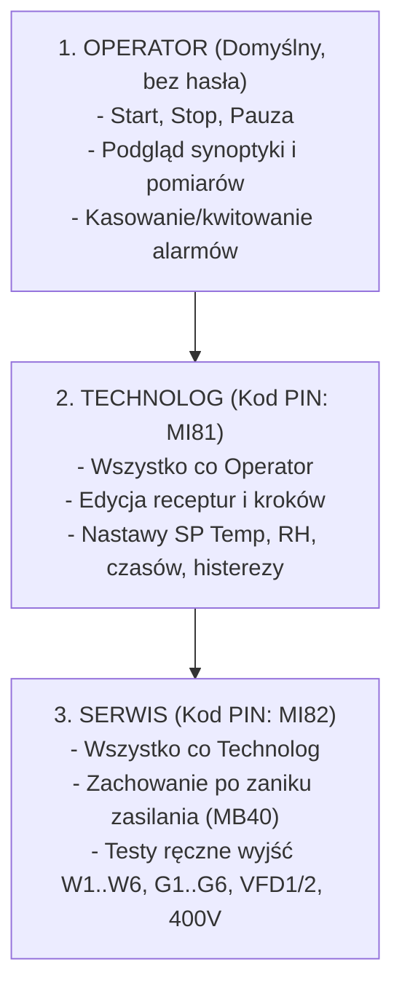
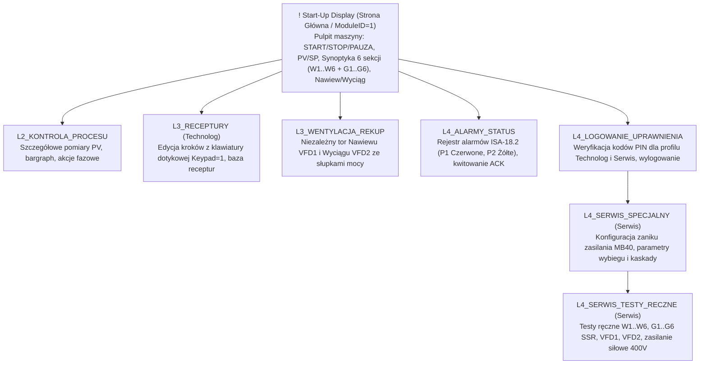

# Implementacja Standardu ANSI/ISA-101.01 w Interfejsie HMI (Vision V350)
## Projekt: Komora Suszarnicza nr 9 (Czysty Elektryk - 6 Sekcji)

Dokument opisuje wdrożenie wytycznych i dobrych praktyk międzynarodowego standardu **ANSI/ISA-101.01-2015** (*Human-Machine Interfaces for Process Automation Systems*) oraz filozofii **High Performance HMI** w systemie sterowania komorą suszarniczą na sterowniku **Unitronics Vision V350-35-RA22** (rozdzielczość matrycy dotykowej: 320x240 pikseli).

---

## 1. Wprowadzenie do Filozofii High Performance HMI / ISA-101

Tradycyjne ekrany HMI projektowane w minionych dekadach charakteryzowały się jaskrawymi kolorami (tzw. "efekt choinki bożonarodzeniowej"), migającymi animacjami i setkami liczb bez kontekstu (*naked numbers*). Badania ASM (*Abnormal Situation Management Consortium*) wykazały, że takie podejście:
- Drastycznie obniża świadomość sytuacyjną operatora (*Situational Awareness*).
- Zwiększa czas reakcji na stany awaryjne nawet o 80%.
- Prowadzi do zmęczenia wzroku podczas wielogodzinnego dyżuru.

Standard **ISA-101** wprowadza rygorystyczne zasady projektowania zorientowanego na człowieka (*User-Centered Design*):
1. **Szybkie wykrywanie anomalii** (operator w 3–5 sekund ocenia stan instalacji).
2. **Kontekstowa prezentacja danych** (PV zawsze w relacji do wartości zadanej SP oraz jednostki fizycznej).
3. **Maksymalna ergonomia dotykowa** (duże przyciski przystosowane do pracy w rękawicach roboczych).
4. **Kolorystyka ze ścisłym przeznaczeniem** (kolor wyłącznie jako sygnał statusu).

---

## 2. Trzy Poziomy Dostępu (Access Levels)

Zgodnie z wymaganiami technologicznymi i bezpieczeństwa, interfejs HMI Komory 9 implementuje 3 poziomy uprawnień:

---

## 3. Matryca Kolorystyczna ISA-101 (Color with Purpose)

Standard ISA-101 jednoznacznie definiuje, że **kolor nie służy do ozdoby, lecz do natychmiastowego kierowania uwagi operatora na anomalie**.

| Element HMI | Tradycyjne podejście (Błędne) | Podejście ISA-101 / High Performance (Wdrożone) | Uzasadnienie inżynierskie |
|---|---|---|---|
| **Tło ekranu** | Czarne, niebieskie lub pstrokate | **Neutralne jasnoszare (Color 74)** | Zmniejsza zmęczenie siatkówki oka, eliminuje odblaski światła na obiekcie przemysłowym. |
| **Karty / Panele** | Losowe kolory | **Jasnoszare (Color 103) z ciemnoszarym obrysem (Color 68)** | Wyraźne fizyczne i logiczne oddzielenie stref funkcjonalnych. |
| **Pracujący napęd / grzałka** | Jaskrawo zielony | **Stonowany zielony (Color 10) + czytelny napis RUN / ON** | Sygnalizuje normalny, pożądany stan pracy. |
| **Wyłączony napęd** | Jaskrawo czerwony | **Muted Dark Gray (Color 68)** | Czerwień jest bezwzględnie zarezerwowana DLA ALARMÓW. |
| **Alarm Krytyczny (P1)** | Migający pstry tekst | **Jednolity czerwony (Color 2) + symbol [!]** | Natychmiastowe zwrócenie uwagi operatora na niebezpieczeństwo (E-STOP, STB > 95°C, zwarcie SSR). |
| **Ostrzeżenie (P2)** | Różne barwy | **Żółty / Bursztynowy (Color 14) + symbol [*]** | Zwraca uwagę na stany przejściowe lub ograniczenia (drzwi otwarte, zanik zasilania). |
| **Pomiary procesowe (PV)** | Losowe czcionki | **Ciemny grafit/czerń na jasnoszarym tle (Font 16x24)** | Maksymalny kontrast i czytelność z odległości 1–2 metrów. |

---

## 4. Architektura 8 Ekranów HMI Komory Suszarniczej nr 9

W odróżnieniu od komór z palnikami gazowymi, Komora nr 9 to **obiekt czysto elektryczny z 6 niezależnymi sekcjami** oraz **niezależną wentylacją nawiewną i wyciągową**.

### Wykaz wygenerowanych ekranów:
1. **`! Start-Up Display` (ModuleID=1, Start-Up)**:
   - Główny pulpit operacyjny maszyny uruchamiany domyślnie po starcie sterownika PLC.
   - Pomiary główne: Temperatura PV (`MI0`) vs SP (`MI31`), Wilgotność PV (`MI1`) vs SP (`MI32`).
   - Panel sterowniczy: START (`MB22`), PAUZA (`MB21`), STOP (`MB20`).
   - Synoptyka 6 sekcji elektrycznych: status 6 wentylatorów obiegowych (`W1:RUN` .. `W6:RUN`) oraz status grzania grzałek elektrycznych SSR (`G1:ON` .. `G6:ON` – natychmiastowe wskazanie, która sekcja aktualnie grzeje).
   - Niezależna wentylacja: status i prędkość (%) nawiewu VFD1 (`MI61`) i wyciągu VFD2 (`MI62`).
2. **`L2_KONTROLA_PROCESU`**:
   - Pomiary wielopunktowe PV, liczba aktywnych sekcji grzałek (`MI50` z 6), słupkowy wskaźnik temperatury (Bargraph), porównanie z SP, przycisk następnego kroku (`MB24`).
3. **`L3_RECEPTURY` (Dostęp: Technolog)**:
   - Bezpośrednia edycja dotykowa parametrów procesu (`Keypad = 1`): SP Temp (`MI31`), SP Wilg (`MI32`), Czas (`MI30`), Histereza (`MI40`), Wydajność wentylacji (`MI34`).
   - Zarządzanie bazą receptur w Data Tables: wybór receptury (`MI70`), zapis do DT (`MB26`).
4. **`L3_WENTYLACJA_REKUP`**:
   - Diagnostyka i sterowanie dwoma niezależnymi torami wentylacji LS S100: Nawiew VFD1 (AO0, `MI61`) oraz Wyciąg VFD2 (AO1, `MI62`).
   - Dynamiczne bargraphy wysterowania oraz przyciski startu twardego.
5. **`L4_ALARMY_STATUS` (Rejestr ISA-18.2)**:
   - Priorytetyzacja: Priorytet 1 (Czerwone: E-STOP, STB, zwarcia SSR, wyłączniki silnikowe), Priorytet 2 (Żółte: drzwi otwarte, zanik zasilania).
   - Przyciski kasowania/kwitowania (`MB23`) i wyciszenia (`MB41`).
6. **`L4_LOGOWANIE_UPRAWNIENIA`**:
   - Weryfikacja PIN Technologa (`MI81` / `MB80`) i Serwisu (`MI82` / `MB81`), powrót do profilu domyślnego Operatora (`MB82`).
7. **`L4_SERWIS_SPECJALNY` (Dostęp: Serwis)**:
   - **Wybór zachowania po zaniku zasilania (`MB40`):**
     - `MB40 = 0`: Wymagane fizyczne potwierdzenie startu przez operatora (tryb bezpieczny).
     - `MB40 = 1`: Automatyczne wznowienie procesu po powrocie zasilania (auto-resume).
   - Czas wybiegu wentylatorów chłodzących (`MI43`), zwłoka kaskadowa sekcji (4 s).
8. **`L4_SERWIS_TESTY_RECZNE` (Dostęp: Serwis)**:
   - Manualne testy 6 wentylatorów obiegowych (`MB90`..`MB95`), 6 sekcji grzałek SSR (`MB96`..`MB101`), nawiewu (`MB102`), wyciągu (`MB103`) i stycznika głównego 400V (`MB104`).
   - Ochrona: aktywna blokada uniemożliwiająca testy w czasie trwania cyklu suszenia.

---

## 5. Procedura Importu Ekranów do VisiLogic

1. Wygenerowany pakiet znajduje się w:
   - [`KOMORA9_HMI_ISA101.vld`](file:///C:/Users/Panasonic/Documents/Agentsroom/Projekt%20PLC%20Unitronics%20V350%20Komora%209/KOMORA9_HMI_ISA101.vld)
2. W środowisku **VisiLogic**:
   - Rozwiń drzewo projektu i kliknij węzeł **HMI Displays**.
   - Wybierz opcję **Import Displays...**.
   - Wybierz plik `KOMORA9_HMI_ISA101.vld` i potwierdź import.
3. Wszystkie 8 ekranów, 236 kontrolek oraz 101 linków PLC zostanie zaimportowanych natychmiast bez konieczności manualnej konfiguracji.
