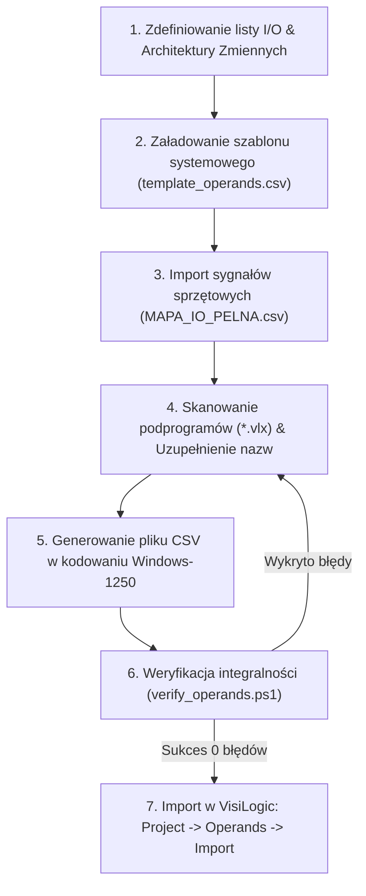

# Generator Operandów VisiLogic (Operands CSV Generator AIO)
### Kompletny pakiet narzędziowy All-In-One do generowania, scalania i walidacji bazy operandów `operands.csv` dla sterowników PLC Unitronics (seria Vision / V350)

---

## 1. Wstęp i Architektura Rozwiązania (AIO)

Pakiet **Operands CSV Generator AIO** to zintegrowane, profesjonalne środowisko automatyzacji zarządzania zmiennymi procesowymi, rejestrami, sygnałami sprzętowymi I/O oraz opisami systemowymi dla oprogramowania **Unitronics VisiLogic**. Został zaprojektowany w taki sposób, aby mógł być wykorzystywany w 100% autonomicznie zarówno przez **inżyniera automatyka**, jak i przez **autonomicznego agenta AI** (LLM).

W środowisku VisiLogic ręczne wprowadzanie setek etykiet zmiennych, bitów pomocniczych, timerów i rejestrów konfiguracyjnych jest procesem żmudnym, podatnym na błędy literowe oraz niespójności z programem logicznym (`*.vlx`). Pakiet ten rozwiązuje ten problem kompleksowo:
- Zapewnia **100% zgodności ze specyfikacją importu VisiLogic** (18 kolumn, 8192 wiersze adresowe, kodowanie Windows-1250 / ANSI).
- Chroni fabryczne opisy rejestrów i bitów systemowych Unitronics (`SB`, `SI`, `SL`, `SDW`).
- Automatycznie pobiera i parsuje sygnały fizyczne z tabeli I/O (`MAPA_IO_PELNA.csv`).
- **Skanuje wygenerowane podprogramy drabinkowe (`*.vlx`)** za pośrednictwem silnika Microsoft Jet OLEDB, wykrywając w logice każde użycie zmiennej i gwarantując, że 100% operandów użytych w programie PLC posiada czytelny opis.

### Struktura katalogów pakietu:

```
narzedzia/generator operands/
├── templates/
│   └── template_operands.csv       # Wzorcowa baza 8192 wierszy z nienaruszonymi opisami systemowymi SB/SI/SL/SDW
├── OperandsBuilder.ps1             # Obiektowy silnik generatora (klasa OperandsBuilder)
├── generate_operands.ps1           # Główny interfejs CLI z automatycznym przełączaniem do SysWOW64
├── verify_operands.ps1             # Rygorystyczny walidator struktury CSV i pokrycia z plikami *.vlx
├── example_demo_operands.ps1       # Wzorcowy skrypt demonstracyjny budujący bazę testową
├── generate_project_operands.ps1   # Dedykowany generator pełnej bazy zmiennych projektu Komora 9
├── DEMO_OPERANDS.csv               # Przykładowy, zweryfikowany plik testowy
└── README.md                       # Niniejsza pełna dokumentacja techniczna, kompendium i kronika
```

### Opis komponentów pakietu:
1. **`OperandsBuilder.ps1`**: Zorientowany obiektowo silnik manipulacji bazą operandów. Zawiera metody importu szablonu, scalania istniejących plików CSV, mapowania wejść/wyjść z plików CSV/Excel, sanityzacji tekstu (usuwanie znaków podziału wiersza, zastępowanie przecinków znakiem `|`, przycinanie do 50 znaków), skanowania bazy Jet OLEDB plików `*.vlx` oraz generowania pliku wynikowego w standardzie CP1250.
2. **`generate_operands.ps1`**: Uniwersalny punkt wejścia CLI. Przyjmuje parametry ścieżek wejściowych i wyjściowych, obsługuje automatyczne nadawanie nazw brakującym zmiennym (`-AutoNameMissing`) i automatycznie przełącza się w tryb 32-bitowy (`SysWOW64`), jeśli wymagane jest skanowanie plików `.vlx`.
3. **`verify_operands.ps1`**: Niezależny audytor integralności. Sprawdza poprawność formatu CSV (nagłówek, 18 kolumn, 8193 linie), limity długości ciągów znaków (max 50 znaków dla pamięci użytkownika), brak duplikatów nazw oraz weryfikuje pełne pokrycie zmiennych z bazy podprogramów `*.vlx`.
4. **`templates/template_operands.csv`**: Czysta matryca operandów wyeksportowana z VisiLogic, zawierająca kompletną bazę fabryczną bitów systemowych (`SB`), rejestrów systemowych (`SI`), rejestrów długich (`SL`) i podwójnych słów systemowych (`SDW`), z wyczyszczoną pamięcią użytkownika.
5. **`generate_project_operands.ps1`**: Skrypt produkcyjny dla projektu Komora 9, scalający dane historyczne, listę I/O, bazę 11 wygenerowanych podprogramów drabinkowych oraz słownik dedykowanych nazw zmiennych procesowych.

---

## 2. Kronika Inżynierska: Droga od Zera do Pełnego Generatora

Opracowanie bezbłędnego generatora wymagało precyzyjnego zbadania mechanizmów importu/eksportu danych w środowisku VisiLogic oraz rozwiązania szeregu subtelnych problemów formatowania.

### 2.1. Pierwsze zetknięcie z VisiLogic i eksportem operandów
Środowisko VisiLogic w menu głównym udostępnia funkcję `Project -> Operands -> Export to CSV`. Wygenerowany plik z pozoru przypomina standardowy arkusz kalkulacyjny, jednak głębsza analiza ujawnia bardzo specyficzne wymagania silnika importującego VisiLogic:

1. **Sztywna liczba wierszy (8192 wiersze danych):**
   VisiLogic nie akceptuje częściowych plików CSV (np. zawierających tylko zdefiniowane 50 zmiennych). Baza operandów sterownika Vision (np. V350) posiada stałą przestrzeń adresową $0 .. 8191$ dla każdego typu pamięci. Plik **musi zawierać dokładnie 8193 linie** (1 linia nagłówka + 8192 wiersze od adresu `0` do `8191`). Brakujący choćby jeden wiersz skutkuje błędem importu.

2. **Układ kolumn (18 kolumn):**
   Kolejność kolumn w nagłówku jest ściśle zdefiniowana:
   ```csv
   Address,MB,MI,MF,ML,MDW,SB,SI,SL,SDW,I,O,T,C,XB,XI,XL,XDW
   ```

3. **Osobliwość "Trailing Comma":**
   Analiza natywnego eksportu VisiLogic wykazała, że każda linia danych kończy się przecinkiem:
   ```csv
   0,,,,,,SB 0 - Always OFF,,,,,,,,,,,,
   ```
   W linii z 18 zdefiniowanymi polami występuje 18 przecinków (co przy standardowym podziale `.Split(',')` daje 19 elementów tablicy, gdzie ostatni element to pusty string). Walidatory i parsery nieuwzględniające tej cechy zgłaszały fałszywe błędy liczby kolumn.

### 2.2. Problem kodowania znaków narodowych (Windows-1250 vs UTF-8)
Podczas pierwszych prób importu plików zapisanych w popularnym standardzie UTF-8 (lub UTF-8 with BOM), polskie znaki diakrytyczne (`ą, ć, ę, ł, ń, ó, ś, ź, ż`) wyświetlały się w VisiLogic jako znaki zapytania w rombach (`?`) lub wielobajtowe "krzaki" (np. `ZaĹ‚Ä…czenie`).

**Przyczyna źródłowa:** VisiLogic jest 32-bitową aplikacją legacy Win32, która nie wspiera natywnego dekodowania UTF-8 w interfejsie bazy operandów. Aplikacja oczekuje danych zakodowanych w jednostronicowym kodowaniu ANSI właściwym dla danego regionu systemu operacyjnego – dla języka polskiego i Europy Środkowej jest to **Windows-1250 (CP1250)**.

**Rozwiązanie:** Wszystkie operacje zapisu i odczytu w `OperandsBuilder.ps1` wymuszają użycie strumienia `[System.Text.Encoding]::GetEncoding(1250)`.

### 2.3. Pułapka przecinków w nazwach zmiennych i opisach fabrycznych
Format VisiLogic nie używa cudzysłowów kwalifikujących tekst (tzw. quote-escaping, np. `"tekst, z przecinkiem"`). Zamiast tego, każdy napotkany znak przecinka `,` jest bezwarunkowo traktowany jako separator nowej kolumny!
Tymczasem fabryczne opisy zmiennych systemowych Unitronics w kolumnie `SI` zawierają teksty takie jak:
`Scan Time, Resolution: Units of 1 mSec`.
Gdyby przecinek ten pozostał w pliku, cała linia uległaby przesunięciu o jedną kolumnę w prawo, powodując trafienie opisu `Units of 1 mSec` do kolumny `SL`, a w konsekwencji uszkodzenie bazy operandów i błąd importu.

**Rozwiązanie:** Wprowadzono regułę sanitacji: każdy przecinek w treści opisu jest automatycznie konwertowany na pionową kreskę `|` (np. `Scan Time| Resolution: Units of 1 mSec`), co zachowuje czytelność opisu i gwarantuje nienaruszalność struktury CSV.

### 2.4. Problem "sierocych" zmiennych w logice PLC
W trakcie generowania podprogramów drabinkowych (`*.vlx`) inżynier lub model AI tworzy szczeble logiki odwołujące się do rejestrów roboczych (np. obliczenia kompensacji, bufory komunikacyjne, bity maszyn stanów). Często zdarza się, że zmienne te działają w logice, ale nie posiadają opisów w bazie operandów, przez co w edytorze VisiLogic widnieją jako anonimowe adresy (np. `MI 210` zamiast `VFD1_Czestotliwosc_Zadana`).

**Przełom inżynierski:** Zintegrowano silnik `OperandsBuilder` z biblioteką Microsoft Jet OLEDB 4.0. Generator potrafi otworzyć pliki binarne `*.vlx`, wyciągnąć pełną listę użytych operandów z tabeli `expimp_LdrElmsOprs`, porównać ją z bazą opisów i:
1. Zgłosić brakujące etykiety.
2. Automatycznie przypisać brakującym zmiennym czytelne, unikalne nazwy techniczne (np. `Var_MI_210`), eliminując ryzyko obecności nieopisanych zmiennych w projekcie.

---

## 3. Kompendium Problemów, Objawów i Procedur Naprawczych (Troubleshooting)

Poniższa tabela stanowi bazę wiedzy diagnostycznej dla inżynierów i autonomicznych agentów AI:

| # | Objaw w VisiLogic / PowerShell | Co się stało (Przyczyna źródłowa) | Skutek awarii | Rozwiązanie problemu |
|---|-------------------------------|----------------------------------|---------------|----------------------|
| **1** | Błąd **"Invalid CSV format"** lub przesunięcie kolumn po imporcie do VisiLogic. | Nazwa zmiennej zawierała przecinek `,`, znak nowego wiersza `\r\n` lub plik miał nieprawidłową liczbę przecinków. | Wartości kolumn przesuwają się (np. opisy wejść trafiają do wyjść), uszkodzenie bazy zmiennych. | Używać metody `SanitizeDescription()` z `OperandsBuilder.ps1`. Wszystkie przecinki zamieniać na `|`. Uruchomić `verify_operands.ps1`. |
| **2** | **"Krzaki" lub znaki zapytania w rombach (`?`)** zamiast polskich liter w VisiLogic. | Plik CSV został zapisany w formacie UTF-8 zamiast Windows-1250 (ANSI). | Nieczytelne nazwy sygnałów na ekranach HMI i w tabeli zmiennych. | Zapisywać plik wyłącznie z kodowaniem `Windows-1250` (`[System.Text.Encoding]::GetEncoding(1250)`). |
| **3** | Błąd importu lub **obcięcie nazwy zmiennej** w polach edycyjnych VisiLogic. | Długość opisu przekroczyła limit 50 znaków (lub 32 znaki w starszych wersjach okien dialogowych). | Ucięcie nazwy zmiennej, utrata czytelności identyfikatora. | `OperandsBuilder` automatycznie przycina opisy do 50 znaków. Warto stosować zwięzłe skróty inżynierskie (np. `TMR_Zwloka_Went`). |
| **4** | **Zduplikowane nazwy** w ramach tego samego typu operandu (np. dwa różne `MB` o nazwie `Alarm_Aktywny`). | Błąd w mapowaniu zmiennych; przypisano ten sam identyfikator do dwóch różnych adresów. | Utrudniona nawigacja w edytorze VisiLogic; ryzyko pomyłki przy wyszukiwaniu zmiennych w LAD. | Walidator `verify_operands.ps1` natychmiast wykrywa i raportuje duplikaty w sekcji ostrzeżeń. |
| **5** | Błąd PowerShell: `The 'Microsoft.Jet.OLEDB.4.0' provider is not registered on the local machine`. | Skanowanie plików `*.vlx` uruchomiono w 64-bitowej konsoli PowerShell (`System32`). Sterownik Jet 4.0 istnieje tylko w wersji 32-bitowej. | Przerwanie skryptu przy próbie analizy plików drabinkowych. | Generator i walidator posiadają wbudowane automatyczne przełączanie do 32-bitowego interpretera (`SysWOW64\powershell.exe`). |
| **6** | Błąd importu: **"File is incomplete"** / niepełna baza. | Plik CSV zawierał mniej niż 8193 linie (np. wycięto puste wiersze adresowe od 500 wzwyż). | VisiLogic odrzuca plik przy imporcie, żądając pełnego zakresu adresowego 0..8191. | Zawsze bazować na pełnym szablonie `template_operands.csv` generującym kompletne 8192 wiersze. |

---

## 4. Kompletna Procedura: Od Pomysłu do Importu w VisiLogic



### Krok 1: Przygotowanie danych wejściowych
Skompletuj listę sygnałów wejść/wyjść w formacie CSV (np. `MAPA_IO_PELNA.csv`) oraz zidentyfikuj kluczowe rejestry sterowania procesem (temperatury, czasy, receptury, statusy falowników).

### Krok 2: Użycie generatora CLI
Możesz wygenerować plik jedną komendą przy użyciu `generate_operands.ps1`:
```powershell
powershell -ExecutionPolicy Bypass -File .\generate_operands.ps1 `
    -OutputPath ".\operands_wynikowe.csv" `
    -TemplatePath ".\templates\template_operands.csv" `
    -InputCsv "..\..\dokumentacja\Visilogic_projekt_operands.csv" `
    -IoCsv "..\..\io-listy\MAPA_IO_PELNA.csv" `
    -VlxDir "..\..\wygenerowane_pliki_projektu\vlx_subroutines" `
    -AutoNameMissing
```

Lub skorzystać z dedykowanego generatora projektu:
```powershell
powershell -ExecutionPolicy Bypass -File .\generate_project_operands.ps1
```

### Krok 3: Weryfikacja poprawności pliku
Przed otwarciem VisiLogic uruchom audytor `verify_operands.ps1`:
```powershell
powershell -ExecutionPolicy Bypass -File .\verify_operands.ps1 -CsvPath ".\wygenerowane_pliki_projektu\Visilogic_operands_complete.csv"
```
*Oczekiwany wynik:*
```
[OK] Liczba wierszy: 8193 (pelna tablica adresowa 0..8191)
[OK] Naglowek CSV zgodny ze standardem VisiLogic (18 kolumn)
[OK] Wszystkie wiersze posiadaja prawidlowa liczbe kolumn (18)
[OK] Zadna nazwa zmiennej uzytkownika nie przekracza limitu 50 znakow
[OK] Brak zduplikowanych nazw w pamieci uzytkownika
[OK] Wszystkie operandy uzyte w podprogramach *.vlx posiadaja opisy w pliku CSV!
[SUKCES] Plik CSV jest w 100% poprawny, kompletny i gotowy do importu w VisiLogic!
```

### Krok 4: Import w programie VisiLogic (Instrukcja Krok po Kroku)
1. Uruchom program **Unitronics VisiLogic** i otwórz projekt (`.vlp`).
2. W górnym pasku menu wybierz: **Project** -> **Operands** -> **Import from CSV**.
3. W oknie wyboru pliku wskaż przygotowany plik `Visilogic_operands_complete.csv`.
4. Program zapyta o potwierdzenie nadpisania bazy operandów – potwierdź klikając **Yes**.
5. Po zakończeniu importu otwórz okno **Operand Descriptions** (ikona tabeli z ołówkiem lub skrót klawiaturowy `Ctrl+D`).
6. Wszystkie zmienne, sygnały I/O oraz rejestry procesowe posiadają teraz profesjonalne, czytelne opisy, zachowując nienaruszone opisy rejestrów systemowych Unitronics.

---

## 5. Instrukcja Dedykowana dla Agentów AI (Prompting & Automation Guide)

Jeśli jesteś agentem AI realizującym zadanie rozbudowy lub integracji bazy zmiennych PLC:
1. **Nigdy nie twórz pliku CSV od zera za pomocą prostych pętli stringów.** Zawsze ładuj `templates/template_operands.csv` za pomocą klasy `[OperandsBuilder]::new()`. Szablon zawiera setki krytycznych definicji bitów i rejestrów systemowych Unitronics (`SB`, `SI`, `SL`, `SDW`), których utrata uniemożliwi diagnostykę sterownika.
2. **Rygorystycznie przestrzegaj kodowania Windows-1250:** Zapis w UTF-8 uszkodzi polskie znaki w VisiLogic.
3. **Nie używaj przecinków w nazwach zmiennych:** Każdy przecinek zostanie potraktowany jako separator kolumn. Używaj znaków podkreślenia `_` lub pionowej kreski `|`.
4. **Przestrzegaj limitu 50 znaków:** Nazwy dłuższe niż 50 znaków zostaną obcięte lub wywołają błąd walidatora.
5. **Przed powiadomieniem użytkownika zawsze uruchom `verify_operands.ps1`:** Dopiero status `[SUKCES]` uprawnia do zaraportowania zakończenia zadania.

---

## 6. Specyfikacja Techniczna i Matryca Typów Operandów VisiLogic

Plik `operands.csv` obsługuje 17 typów pamięci sterownika Unitronics Vision:

| Kolumna | Typ | Pełna nazwa | Rozmiar | Dozwolony zakres adresów | Przeznaczenie |
|:---:|:---:|:---|:---:|:---:|:---|
| **Address** | - | Indeks adresu | - | `0 .. 8191` | Adres komórki w przestrzeni pamięci |
| **MB** | Bit | Memory Bit | 1 bit | `0 .. 8191` | Bity wewnętrzne użytkownika (flagi, zezwolenia, etapy) |
| **MI** | Integer | Memory Integer | 16-bit (Signed) | `0 .. 8191` | Rejestry całkowite (-32768 .. 32767), pomiary analogowe |
| **MF** | Float | Memory Float | 32-bit (IEEE 754) | `0 .. 8191` | Liczby zmiennoprzecinkowe (dokładne obliczenia fizyczne) |
| **ML** | Long | Memory Long | 32-bit (Signed) | `0 .. 8191` | Rejestry 32-bitowe ze znakiem (duże liczniki, czasy w sekundach) |
| **MDW** | DWord | Memory Double Word | 32-bit (Unsigned) | `0 .. 8191` | Podwójne słowa bez znaku (maski bitowe, sumy kontrolne) |
| **SB** | Bit | System Bit | 1 bit | `0 .. 8191` | Bity systemowe Unitronics (SB 0 = Always OFF, SB 1 = Always ON) |
| **SI** | Integer | System Integer | 16-bit | `0 .. 8191` | Rejestry systemowe (Scan Time, kody błędów COM, zegar RTC) |
| **SL** | Long | System Long | 32-bit | `0 .. 8191` | Rejestry systemowe 32-bitowe |
| **SDW** | DWord | System Double Word | 32-bit | `0 .. 8191` | Rejestry systemowe podwójnych słów (statystyki sieciowe) |
| **I** | Bit | Digital Input | 1 bit | `0 .. 8191` | Fizyczne wejścia cyfrowe sterownika i modułów rozszerzeń |
| **O** | Bit | Digital Output | 1 bit | `0 .. 8191` | Fizyczne wyjścia przekaźnikowe / tranzystorowe |
| **T** | Timer | Timer | Struktura (32-bit) | `0 .. 8191` | Timery sprzętowe (preset, current, status bit) |
| **C** | Counter | Counter | 16-bit | `0 .. 8191` | Liczniki sprzętowe |
| **XB** | Bit | Extended Bit | 1 bit | `0 .. 8191` | Rozszerzona pamięć bitowa |
| **XI** | Integer | Extended Integer | 16-bit | `0 .. 8191` | Rozszerzona pamięć 16-bitowa (np. receptury suszenia) |
| **XL** | Long | Extended Long | 32-bit | `0 .. 8191` | Rozszerzona pamięć 32-bitowa |
| **XDW** | DWord | Extended Double Word| 32-bit | `0 .. 8191` | Rozszerzone podwójne słowa |
