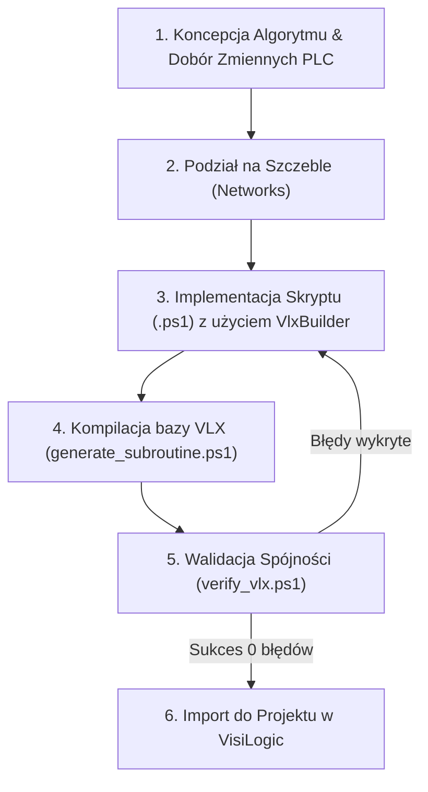

# Generator Podprogramów VisiLogic (VLX Generator AIO)
### Kompletny pakiet narzędziowy All-In-One do generowania i walidacji podprogramów `*.vlx` dla sterowników PLC Unitronics (seria Vision / V350)

---

## 1. Wstęp i Architektura Rozwiązania (AIO)

Pakiet **VLX Generator AIO** to zintegrowane, profesjonalne środowisko automatyzacji wytwarzania podprogramów drabinkowych (Ladder Logic Subroutines) dla oprogramowania **Unitronics VisiLogic**. Został zaprojektowany w taki sposób, aby mógł być wykorzystywany w 100% autonomicznie zarówno przez **inżyniera automatyka**, jak i przez **autonomicznego agenta AI** (LLM).

Rozwiązanie eliminuje konieczność ręcznego "wyklikiwania" powtarzalnych, skomplikowanych algorytmów drabinkowych w edytorze VisiLogic, umożliwiając generowanie gotowych, poprawnie sformatowanych geometrycznie i w pełni spójnych relacyjnie plików `*.vlx` w ułamku sekundy.

### Struktura katalogów pakietu:

```
narzedzia/generator subroutine/
├── templates/
│   └── template.vlx          # Wzorcowa, czysta baza Access/Jet z poprawną strukturą tabel
├── VlxBuilder.ps1             # Obiektowy silnik generatora (klasy VlxBuilder, VlxOpcodes, VlxOperandTypes)
├── generate_subroutine.ps1    # Główny interfejs CLI z automatycznym przełączaniem do 32-bit (SysWOW64)
├── verify_vlx.ps1             # Walidator integralności relacyjnej i poprawności geometrii pliku VLX
├── example_demo.ps1           # Wzorcowy skrypt demonstracyjny budujący podprogram
└── README.md                  # Niniejsza pełna dokumentacja techniczna, kompendium i kronika
```

### Opis komponentów:
1. **`VlxBuilder.ps1`**: Rdzeń systemu. Implementuje silnik relacyjny OLEDB, zarządza kluczami głównymi/obcymi, geometrią współrzędnych siatki VisiLogic (Grid 0..80 x 0..60), automatycznym łączeniem bloków przewodami (Wires) oraz rejestracją operandów i stałych.
2. **`generate_subroutine.ps1`**: Uniwersalny punkt wejścia. Wykrywa architekturę interpretera PowerShell i automatycznie re-startuje proces w 32-bitowym podsystemie `SysWOW64`, co jest wymagane przez sterownik `Microsoft.Jet.OLEDB.4.0`.
3. **`verify_vlx.ps1`**: Rygorystyczny audytor pliku `.vlx`. Weryfikuje strukturę bazy danych przed importem do VisiLogic (sprawdza szczebel Return, unikalność ID, brak wartości NULL mogących wywołać crash, poprawność powiązań parametrów).
4. **`example_demo.ps1`**: Pełny przykład implementacji zawierający logikę styków, komparatorów, bloków arytmetycznych i skalowania.
5. **`templates/template.vlx`**: Szablon bazodanowy ze zdefiniowanymi typami danych Jet 4.0, indeksem i hasłem systemowym Unitronics.

---

## 2. Kronika Inżynierska: Droga od Zera do Pełnego Generatora

Stworzenie generatora wymagało przeprowadzenia pełnej inżynierii wstecznej formatu plików podprogramów Unitronics VisiLogic. Poniżej przedstawiono kolejne etapy badań i przełomów technologicznych.

### 2.1. Pierwsze zetknięcie z VisiLogic i formatem `.vlx`
Oprogramowanie VisiLogic umożliwia eksport i import podprogramów za pośrednictwem plików z rozszerzeniem `.vlx` (*VisiLogic Subroutine Export*). Pliki te nie są tekstem ani formatem XML/JSON – analiza nagłówka heksadecymalnego ujawniła sygnaturę `Standard Jet DB`:
```
00000000: 00 01 00 00 53 74 61 6e 64 61 72 64 20 4a 65 74  ....Standard Jet
00000010: 20 44 42 00 01 00 00 00 00 00 00 00 00 00 00 00   DB.............
```
Oznacza to, że plik `.vlx` jest w rzeczywistości kontenerem relacyjnej bazy danych **Microsoft Access 97 / Jet 4.0**.

### 2.2. Złamanie zabezpieczeń i dostęp do danych
Próba otwarcia pliku w programie Microsoft Access lub przez standardowy ciąg połączeniowy OLEDB kończyła się błędem autoryzacji: *Not a valid password*.
Dalsza analiza pamięci i ciągów znaków binariów VisiLogic ujawniła uniwersalne hasło bazodanowe stosowane przez Unitronics:
```
Hasło Jet OLEDB: UniOpenSesame
Provider: Microsoft.Jet.OLEDB.4.0
```
Ciąg połączeniowy umożliwiający swobodny odczyt i zapis danych:
```powershell
"Provider=Microsoft.Jet.OLEDB.4.0;Data Source=$Path;Jet OLEDB:Database Password=UniOpenSesame;"
```

### 2.3. Architektura bazy danych `.vlx` – Struktura Tabel
Plik bazy danych zawiera zestaw tabel z prefiksem `expimp_`:
1. **`expimp_Subroutine`**: Metadane podprogramu (nazwa, unikalne ID podprogramu, ID projektu).
2. **`expimp_LdrStrips`**: Szczebel drabinki (Network / Strip). Definiuje kolejność (`StripNum`), komentarz szczebla oraz flagę szczebla powrotu (`IsReturnStrip = -1` dla `Return`).
3. **`expimp_LdrElements`**: Elementy umieszczone na drabince (styki, cewki, bloki funkcyjne, przewody). Zawiera typ elementu (`ElmntType`) oraz współrzędne wirtualnej siatki `(Xs, Ys, Xe, Ye)`.
4. **`expimp_LdrWires`**: Połączenia elektryczne/logiczne między pinami elementów.
5. **`expimp_LdrOperands`**: Słownik operandów PLC używanych w podprogramie (MB, MI, ML, DW, Timery oraz wartości stałe liczbowe).
6. **`expimp_LdrElmsOprs`**: Kluczowa tabela relacji: wiąże konkretny element (`ElmntID`) z operandem (`Elmnt_Oprnd_Adrs`), określa indeks wejścia/wyjścia (`Elmnt_Oprnd_Index`) oraz typ operandu.
7. **`expimp_LdrElmsParams`**: Parametry konfiguracyjne bloków (np. stałe formatujące, tryby pracy).

### 2.4. Rozwikłanie geometrii siatki (Grid Coordinates)
Edytor drabinkowy VisiLogic opiera się na stałej siatce dyskretnej:
- Oś pozioma $X$: zakres `0 .. 80` (szerokość szczebla). Szyna zasilająca znajduje się na pozycji $X=0$. Prawa szyna (cewki) kończy się na $X=79..80$.
- Oś pionowa $Y$: zakres `0 .. 60` (wysokość szczebla wiersza).

**Kluczowe odkrycia geometryczne:**
- **Styki (Contacts)**: posiadają szerokość 6 jednostek ($Xe = Xs + 6$).
- **Cewki (Coils)**: umieszczane na prawej krawędzi ($Xs = 74, Xe = 80$).
- **Komparatory**: szerokość 13 jednostek ($Xe = Xs + 13$).
- **Bloki funkcyjne (Math, Store, Linearize)**: szerokość 13 do 17 jednostek.
- **Oś magistrali sygnałowej**: Wejście zezwalające `EN` (Enable) wszystkich bloków funkcyjnych oraz wejście styków znajduje się ściśle na wysokości **$Ys = 4$**. Użycie dowolnej innej współrzędnej $Y$ dla elementów w pierwszym wierszu powodowało powstawanie nieestetycznych załamań linii ("schodków") lub całkowite zerwanie logiki.

---

## 3. Kompendium Problemów, Objawów i Procedur Naprawczych (Troubleshooting)

Podczas prac badawczo-rozwojowych zidentyfikowano i skatalogowano 6 krytycznych problemów integracyjnych. Poniższa tabela stanowi bazę wiedzy diagnostycznej dla inżynierów i agentów AI.

| # | Objaw w VisiLogic / PowerShell | Co się stało (Przyczyna źródłowa) | Skutek awarii | Rozwiązanie problemu |
|---|-------------------------------|----------------------------------|---------------|----------------------|
| **1** | **Crash VisiLogic** natychmiast przy kliknięciu Import (`Fatal Error`, zrzut pamięci). | Wartości `NULL` w tabeli `expimp_LdrElmsOprs` w polach `Elmnt_Oprnd_Type` lub `Elmnt_Oprnd_Adrs`. | Program VisiLogic natychmiast wyłącza się, utrata niezapisanych danych projektu. | Używać wyłącznie `VlxBuilder`, który wymusza brak wartości NULL. Przed importem uruchomić `verify_vlx.ps1`. |
| **2** | Błąd **"Failed to import subroutine"** lub odmowa importu mimo braku crasha. | W projekcie istniały już puste podprogramy o takich samych nazwach lub nastąpił konflikt ID podprogramu. | VisiLogic odrzuca plik lub importuje pusty szczebel. | Usunąć istniejące puste podprogramy z drzewa projektu przed importem lub nadać nową nazwę w skrypcie. |
| **3** | **Brak połączeń logicznych** między blokami (bloki "wiszą" w powietrzu, czerwone linie błędu). | Brak wpisu w `expimp_LdrWires` lub luka we współrzędnych $X$ ($Xe_{poprzedni} < Xs_{nastepny}$). | Drabinka nie kompiluje się, brak przepływu sygnału sterującego. | Zawsze łączyć elementy przewodem poziomym `AddWireHorizontal(x1, x2, y)` lub wywoływać metody styków z parametrem auto-wire. |
| **4** | **Załamania i uskoki na liniach połączeń** ("schodki" w drabince). | Niezgodność osi pionowej $Y$ pomiędzy stykami a wejściami bloków funkcyjnych (np. styk na $Y=4$, blok na $Y=14$). | Nieczytelny schemat, trudna diagnostyka wizualna w runtime. | Utrzymywać stałą wysokość magistrali sygnałowej **$Ys = 4$** dla całego pierwszego poziomu szczebla. |
| **5** | Błąd w PowerShell: `The 'Microsoft.Jet.OLEDB.4.0' provider is not registered on the local machine`. | Próba uruchomienia skryptu w 64-bitowej wersji PowerShell (`System32`). Sterownik Jet 4.0 istnieje tylko w wersji 32-bitowej. | Skrypt przerywa działanie, plik VLX nie zostaje wygenerowany. | Uruchamiać skrypt przez `generate_subroutine.ps1` (posiada wbudowane auto-przełączanie do `SysWOW64\powershell.exe`). |
| **6** | Wartości liczbowe w blokach Math/Store/Comp są **puste lub wyzerowane** po imporcie. | Użyto stałej liczbowej, ale nie zarejestrowano jej rekordu w tabeli `expimp_LdrOperands` (typ 37). | Blok operuje na wartości 0 zamiast zadanej liczby. | Metoda `RegisterOperand` w `VlxBuilder` automatycznie dodaje rekord do `expimp_LdrOperands` dla każdego parametru stałego. |

---

## 4. Kompletna Procedura: Od Pomysłu do Gotowego Pliku .vlx

Procedura wytwórcza składa się z 6 precyzyjnie zdefiniowanych kroków:



### Krok 1: Analiza wymagań i dobór operandów
Zdefiniuj listę zmiennych wejściowych, wyjściowych i pamięci pośredniej zgodnie z mapą pamięci PLC (np. bity `MB`, rejestry `MI`, rejestry długie `ML`, timery `T`).

### Krok 2: Podział na szczeble (Networks)
Zaprojektuj logikę dzieląc ją na czytelne, jednotematyczne szczeble drabinki. Pamiętaj:
- Każdy szczebel zaczyna się od szyny prądowej ($X=0$).
- Ostatnim elementem każdego podprogramu **musi być szczebel Return** (`AddReturnStrip()`).

### Krok 3: Implementacja skryptu budującego
Utwórz plik skryptu PowerShell (np. `MojaLogika.ps1`). Wykorzystaj płynne API `VlxBuilder`:
```powershell
$builder = [VlxBuilder]::new("NazwaPodprogramu", $VlxPath)
$builder.InitializeFromTemplate($TemplatePath)

# Szczebeł 1: Załączenie pompy przy spełnieniu warunku
$s1 = $builder.AddStrip("Sterowanie pompy obiegowej")
$builder.AddContactDirect($s1, 0, 4, [VlxOperandTypes]::MB, 100) # MB100 Start
$builder.AddWireHorizontal($s1, 6, 74, 4)
$builder.AddCoilDirect($s1, 74, 4, [VlxOperandTypes]::MB, 200)   # MB200 Pompa Praca

# Obowiązkowy szczebel zamykający
$builder.AddReturnStrip()
$builder.Close()
```

### Krok 4: Generowanie pliku VLX
Uruchom generator przez uniwersalny interfejs CLI:
```powershell
powershell -ExecutionPolicy Bypass -File .\generate_subroutine.ps1 -ScriptPath .\MojaLogika.ps1 -OutputPath .\MojaLogika.vlx
```

### Krok 5: Weryfikacja integralności relacyjnej
Przed importem upewnij się, że plik jest w 100% poprawny technicznie:
```powershell
powershell -ExecutionPolicy Bypass -File .\verify_vlx.ps1 -VlxPath .\MojaLogika.vlx
```
*Oczekiwany wynik: `Podsumowanie weryfikacji: Błędy: 0, Ostrzeżenia: 0`.*

### Krok 6: Import do oprogramowania VisiLogic
1. Otwórz projekt `.vlp` w programie **Unitronics VisiLogic**.
2. W drzewie projektu (*Solution Explorer*) rozwiń gałąź **Subroutines**.
3. **Upewnij się, że w drzewie NIE MA pustego podprogramu o takiej samej nazwie** (jeśli jest – usuń go przed importem!).
4. Kliknij prawym przyciskiem myszy na gałąź **Subroutines** -> wybierz **Import Subroutine**.
5. Wskaż wygenerowany plik `MojaLogika.vlx`.
6. Podprogram pojawi się w drzewie z idealnie wyrównaną geometrią i kompletnymi połączeniami.

---

## 5. Instrukcja Dedykowana dla Agentów AI (Prompting & Automation Guide)

Jeśli jesteś agentem AI realizującym zadanie rozbudowy programu PLC:
1. **Nie generuj baz Jet OLEDB od zera poprzez skrypty binarne.** Zawsze twórz kopię szablonu `templates/template.vlx` i modyfikuj ją za pośrednictwem biblioteki `VlxBuilder.ps1`.
2. **Zachowuj regułę $Ys = 4$:** Wszystkie styki i wejścia `EN` bloków funkcyjnych na głównej linii muszą mieć współrzędną $Y=4$.
3. **Zawsze zamykaj podprogram metodą `$builder.AddReturnStrip()`:** Brak szczebla Return Strip uniemożliwi kompilację projektu w VisiLogic.
4. **Zawsze uruchamiaj generator przez `generate_subroutine.ps1`:** Zapobiega to błędom architektury 64-bit PowerShell.
5. **Audytuj wynik za pomocą `verify_vlx.ps1`:** Jeśli walidator zgłosi błąd, popraw skrypt generujący przed powiadomieniem użytkownika.

---

## 6. Specyfikacja API VlxBuilder i Kody Rozkazów (Opcode Matrix)

### Tabela Typów Operandów (`[VlxOperandTypes]`):
| Kod Typu | Symbol | Nazwa typu pamięci | Rozmiar / Zakres |
|:---:|:---:|:---|:---|
| `0` | **MB** | Memory Bit | 1 bit (0/1) |
| `1` | **MI** | Memory Integer | 16-bit ze znakiem (-32768 .. 32767) |
| `2` | **ML** | Memory Long Integer | 32-bit ze znakiem |
| `3` | **DW** | Double Word | 32-bit bez znaku (0 .. 4294967295) |
| `4` | **MF** | Memory Float | 32-bit zmiennoprzecinkowy IEEE 754 |
| `5` | **T** | Timer Current Value | Wartość bieżąca timera |
| `8` | **XB** | Extended Bit | Pamięć rozszerzona bitowa |
| `9` | **XI** | Extended Integer | Pamięć rozszerzona 16-bit |
| `37` | **Const** | Wartość stała (Immediate) | Liczba wprowadzona bezpośrednio |

### Tabela Kodów Rozkazów (`[VlxOpcodes]`):
| Opcode | Nazwa Instrukcji | Kategoria | Szerokość ($Xe - Xs$) | Opis działania |
|:---:|:---|:---|:---:|:---|
| `100` | Wire Horizontal | Łącznik | zmienna | Poziomy przewód logiczny |
| `101` | Wire Vertical | Łącznik | 0 ($Xe=Xs$) | Pionowy przewód łączący gałęzie |
| `200` | Direct Contact | Styk | 6 | Zwykły styk normalnie otwarty (NO) |
| `201` | Inverted Contact | Styk | 6 | Styk normalnie zamknięty (NC) |
| `202` | Positive Transition Contact | Styk | 6 | Detekcja zbocza narastającego (P) |
| `203` | Negative Transition Contact | Styk | 6 | Detekcja zbocza opadającego (N) |
| `204` | Direct Coil | Cewka | 6 | Zwykła cewka wyjściowa |
| `205` | Inverted Coil | Cewka | 6 | Odwrócona cewka wyjściowa |
| `206` | Set Coil | Cewka | 6 | Ustawienie bitu (Latch / SET) |
| `207` | Reset Coil | Cewka | 6 | Skasowanie bitu (Unlatch / RESET) |
| `212` | Toggle Coil | Cewka | 6 | Przełączenie stanu bitu (Toggle) |
| `300` | Equal (`=`) | Komparator | 13 | Porównanie równości: $A = B$ |
| `301` | Greater Than (`>`) | Komparator | 13 | Porównanie większości: $A > B$ |
| `302` | Greater/Equal (`>=`) | Komparator | 13 | Porównanie: $A \ge B$ |
| `303` | Less Than (`<`) | Komparator | 13 | Porównanie mniejszości: $A < B$ |
| `304` | Less/Equal (`<=`) | Komparator | 13 | Porównanie: $A \le B$ |
| `305` | Not Equal (`<>`) | Komparator | 13 | Porównanie nierówności: $A \neq B$ |
| `400` | Add (`+`) | Arytmetyka | 13 | Dodawanie: $A + B = C$ |
| `401` | Subtract (`-`) | Arytmetyka | 13 | Odejmowanie: $A - B = C$ |
| `405` | Multiply (`*`) | Arytmetyka | 13 | Mnożenie: $A \times B = C$ |
| `406` | Divide (`/`) | Arytmetyka | 13 | Dzielenie całkowite: $A / B = C$ |
| `407` | Modulo | Arytmetyka | 13 | Reszta z dzielenia |
| `601` | Call Subroutine | Skok | 13 | Wywołanie innego podprogramu |
| `602` | Return | Powrót | 6 | Bezwarunkowy powrót z podprogramu |
| `900` | Store | Pamięć | 13 | Przypisanie wartości: $A \to B$ |
| `1300` | Linearize | Funkcja | 17 | Przeskalowanie liniowe (Y = f(X)) |
| `1500` | Increment | Arytmetyka | 13 | Inkrementacja wartości o 1 ($A + 1 \to A$) |
| `1501` | Decrement | Arytmetyka | 13 | Dekrementacja wartości o 1 ($A - 1 \to A$) |
