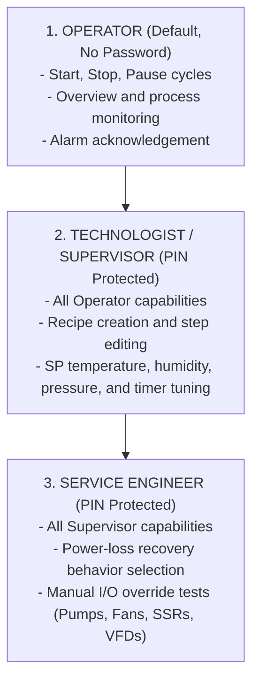

# ANSI/ISA-101.01 Standard Implementation Guide for Unitronics Vision Series HMI
### High-Performance HMI Guidelines for 320x240 Touchscreen Displays (Vision V350 / V130 / Samba)

---

## 1. Introduction to the High-Performance HMI Philosophy (ISA-101)

Traditional HMI displays often featured vibrant, chaotic color schemes ("Christmas tree effect"), animated rotating equipment, and dense walls of raw numbers without context (*naked numbers*). Research conducted by the **Abnormal Situation Management (ASM) Consortium** established that:
- Cluttered, high-saturation screens degrade operator **situational awareness**.
- Operator response time during critical plant upsets increases by up to **80%**.
- Prolonged exposure causes visual fatigue during long monitoring shifts.

The **ANSI/ISA-101.01-2015** standard (*Human-Machine Interfaces for Process Automation Systems*) establishes rigorous principles for **user-centered industrial design**:
1. **Rapid Anomaly Detection**: Operators can evaluate system health in **3 to 5 seconds**.
2. **Contextual Data Presentation**: Process values (PV) are always accompanied by their engineering units, setpoints (SP), and operating limits.
3. **Ergonomic Touch Targets**: Large touch zones designed for industrial gloves.
4. **Color with Purpose**: Color is strictly reserved to signal abnormal or changing conditions.

---

## 2. Multi-Tier Role-Based Security Architecture

Industrial applications require clear role-based access control to prevent unauthorized modification of recipes and safety thresholds:



---

## 3. The ISA-101 Color Matrix (Color with Purpose)

Under ISA-101, **color is not decoration—it directs immediate attention to process abnormalities**:

| HMI Element | Traditional Approach (Non-Compliant) | ISA-101 High Performance (Standard) | Engineering Rationale |
|:---|:---|:---|:---|
| **Screen Background** | Black, bright blue, or high contrast | **Neutral Light Gray (`ColorBack = 74`)** | Minimizes eye fatigue, reduces glare under industrial facility lighting. |
| **Grouping Panels** | Arbitrary colors | **Muted Gray (`103`) with Dark Border (`68`)** | Visually partitions functional zones without visual distraction. |
| **Running Equipment** | Saturated bright green | **Muted Green (`10`) with unambiguous RUN label** | Confirms normal operating state without competing for attention. |
| **Stopped Equipment** | Saturated bright red | **Muted Dark Gray (`68`) or Off-White** | **Red is strictly reserved for ALARMS**. |
| **Critical Alarm (Priority 1)**| Flashing multi-color text | **Solid High-Contrast Red (`2`) with `[!]` badge** | Immediate identification of critical safety trips (E-STOP, Over-temperature, Trip). |
| **Warning (Priority 2)** | Assorted colors | **Amber / Industrial Yellow (`14`) with `[*]` badge** | Signals conditions requiring intervention before tripping (door open, power sag). |
| **Process Values (PV)** | Random neon fonts | **Dark Charcoal/Black on Light Gray (16x24 font)** | Maximum contrast readable from 1 to 2 meters. |

---

## 4. Multi-Display Navigation Hierarchy

High-performance HMI systems organize screens into four functional levels:

```text
Level 1: System Overview (Main Dashboard & Master Machine State)
  │
  ├── Level 2: Detailed Process Control (Loop Tuning, Subsystems, Trends)
  │
  ├── Level 3: Parameter & Recipe Management (Technologist Access)
  │
  └── Level 4: Diagnostics, Alarms (ISA-18.2) & Manual Service Override
```

### 1. Level 1: System Overview (Startup Display - `ModuleID = 1`)
- Master machine status banner: Cycle state, active step number, elapsed time.
- Essential Key Performance Indicators (KPIs): Primary PV vs SP.
- High-level equipment synoptic with immediate RUN/OFF badges.
- Prominent master control touch buttons: `[ START ]`, `[ PAUSE ]`, `[ STOP ]`.
- Permanent bottom navigation bar ("One-Click" display switching).

### 2. Level 2: Subsystem Operation & Process Loops
- Dedicated subsystem views (e.g. Ventilation, Heating, Pumping, Reactants).
- Multi-channel analog measurements with dynamic bargraphs.
- High/low limit markers indicating normal operating envelopes.

### 3. Level 3: Recipe & Parameter Management
- Touch-editable numeric variables (`Keypad = 1`) for process setpoints.
- Data Table recipe selection, saving, and downloading into PLC memory.
- Protected behind Technologist PIN authorization.

### 4. Level 4: Alarms & Manual Service Overrides
- Categorized alarm logs conforming to **ANSI/ISA-18.2** (Priority 1 Critical vs Priority 2 Warning).
- Direct Alarm Reset (`MB`) and Horn Silence (`MB`) buttons.
- Service mode allowing manual toggling of discrete outputs (relays, contactors, VFD run commands) during machine STOP.

---

## 5. Touchscreen Ergonomics on 320x240 QVGA Displays

The Unitronics Vision V350 utilizes an analog resistive touchscreen. Designing for industrial environments requires:

1. **Minimum Touch Target Dimensions**:
   - Master Command Buttons: minimum **$80 \times 36$ pixels**.
   - Standard Navigation Buttons: minimum **$58 \times 24$ pixels**.
   - Spacing: minimum **4 pixels** between adjacent touch zones to prevent accidental finger misplacement when operators wear gloves.
2. **Numeric Keypad Overlay (`Keypad = 1`)**:
   - Numeric variables configured for user entry pop up the native VisiLogic virtual numeric keypad.
   - Configure clear high/low validation boundaries (`MinValue` and `MaxValue`) in the operand database to prevent out-of-range setpoints.
3. **Screen Real Estate Layout**:
   - **Top Title Banner**: $Y = 0 \dots 24$ px (Header, screen title, heartbeat indicator).
   - **Main Graphic Workspace**: $Y = 25 \dots 205$ px (Panels, synoptic meters, process data).
   - **Bottom Navigation Bar**: $Y = 206 \dots 239$ px (Quick tab buttons across all screens).
