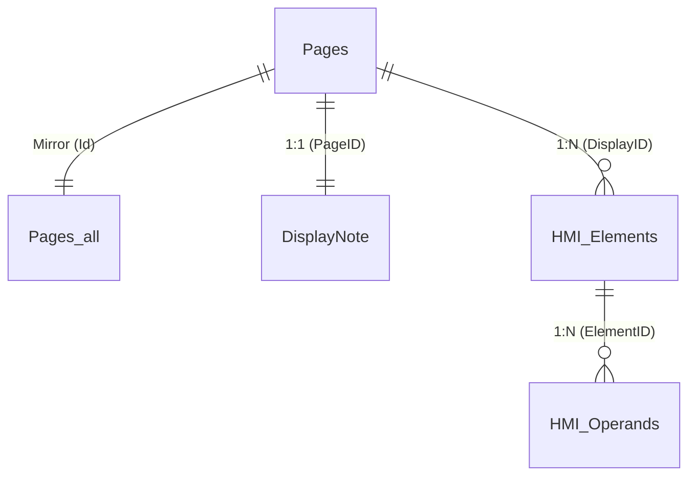
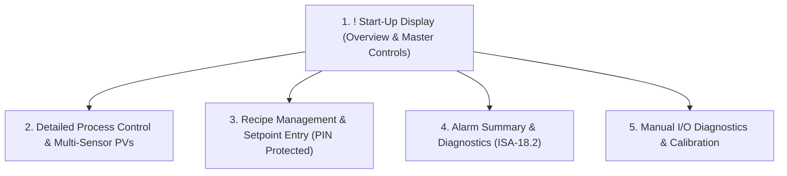

# VisiLogic HMI Displays Generator (.VLD) - All-In-One (AIO) Engine
## ANSI/ISA-101.01 Standard | High-Performance HMI for Unitronics Vision Series PLCs (V130, V350, V430, V570, V1040, V1210)

A professional automation engine designed to programmatically generate, assemble, and export operator HMI display packages in native `.vld` (VisiLogic Displays) format for **Unitronics Vision Series** controllers (specifically optimized for QVGA 320x240 color touchscreen models such as the **V350-35-RA22**, and modular series).

---

## Table of Contents
1. [Introduction and Architecture](#1-introduction-and-architecture)
2. [Reverse Engineering Chronicle: Format Discovery & Mechanics](#2-reverse-engineering-chronicle-format-discovery--mechanics)
3. [Internal Structure of the .VLD Container & Jet 4.0 Database](#3-internal-structure-of-the-vld-container--jet-40-database)
4. [HMI Controls Catalog & Binary Properties](#4-hmi-controls-catalog--binary-properties)
5. [Toolkit Components](#5-toolkit-components)
6. [Step-by-Step Generation and Import Workflow](#6-step-by-step-generation-and-import-workflow)
7. [Industrial Multi-Screen HMI Architecture](#7-industrial-multi-screen-hmi-architecture)
8. [Database Integrity Auditor (verify_displays.ps1)](#8-database-integrity-auditor-verify_displaysps1)
9. [Troubleshooting & Diagnostics Reference](#9-troubleshooting--diagnostics-reference)

---

## 1. Introduction and Architecture

In the **Unitronics VisiLogic** engineering environment, graphical operator screens (HMI Displays) can be imported and exported via `.vld` container files. This format facilitates moving individual screens or entire multi-display packages between projects without manually drawing visual elements in the GUI.

This generator eliminates tedious, pixel-by-pixel graphic placement in VisiLogic's editor. It empowers control engineers and automated AI workflows to:
- Programmatically construct displays, group containers, buttons, numeric entry variables with virtual keypad overlays (`Keypad=1`), and dynamic meters (Bargraphs, Dial Gauges, and Tank indicators).
- Enforce strict pixel positioning within the discrete 320x240 display coordinate space.
- Comply fully with the **ANSI/ISA-101.01-2015 (High Performance HMI)** standard (neutral grayscale backgrounds, muted operational colors, with high-contrast color strictly reserved for alarm status).
- Implement multi-tier role-based access security (Operator, Technician, Service Engineer).
- Automatically link graphic elements to PLC process variables (**MB**, **MI**, **DW**, **ML**).
- Perform pre-import relational integrity and geometry validation.

---

## 2. Reverse Engineering Chronicle: Format Discovery & Mechanics

### Step 1: Identifying the `.vld` Container Format
Analysis of reference `.vld` files exported from active VisiLogic installations revealed the standard PKWare ZIP signature at offset 0x00:
```text
50 4B 03 04 (PK..) -> Standard PKWare ZIP archive
```
Extracting the archive revealed a single embedded file:
```text
HMIBufferColorPages.udb (uncompressed size: ~614 KB)
```

### Step 2: Dissecting `HMIBufferColorPages.udb`
Inspecting the `.udb` binary header:
- The byte signature at offset 0x00 matches a **Standard Jet DB** (`Microsoft Access Jet 4.0 / ACE OLEDB`).
- Unlike `.vlp` projects and `.vlx` subroutines (which are protected with the system password `UniOpenSesame`), `HMIBufferColorPages.udb` has **no database password**, permitting direct querying and record creation via `Microsoft.Jet.OLEDB.4.0` or `Microsoft.ACE.OLEDB.12.0`.

### Step 3: Schema and Relational Dependencies
1. `Pages` and `Pages_all`: Store display metadata (`ID`, `Description`, background color `ColorBack=74`, and `ModuleID`: 1 for Start-Up Display, 2 for standard pages). Both tables must maintain an identical set of records.
2. `DisplayNote`: Stores page documentation buffers linked by `PageID`. VisiLogic strictly requires a matching record for every defined `PageID` with a 510-byte zeroed binary buffer. Omitting this record causes memory access violations when opening display properties.
3. `HMI_Elements`: Core graphic controls table. Defines coordinate geometry (`Xs`, `Ys`, `Dx`, `Dy`), palette color codes (`ColorFore`, `ColorBack`), control classification codes (`Type`, `VarType`), label text, and OLE Property Bag bytes in `[Binary]`.
4. `HMI_Operands`: Binds controls to PLC memory registers. Links `ElementID` with memory type (`OprndType`: MB=1, MI=3), physical address (`OprndAddr`), and operand purpose (`OprndPurpose`: 1 for process read, 2 for touch bit).
5. Auxiliary tables: `HW_Elements`, `tblFonts`, `ProjectImages`, `TblOperandTypes`.

### Step 4: Decoding `[Binary]` Property Bags
Hexadecimal inspection revealed that complex process controls (numeric variables, bargraphs, gauges) store their format configuration in serialized OLE Property Bags:
- **Numeric Variable (VarType = 8):** 1,740-byte buffer specifying integer/fractional digit count, leading zero suppression, sign display, and virtual touchscreen keypad properties.
- **Bargraph (VarType = 24):** 624-byte buffer defining orientation, high/low threshold colors, and tick graduation.
- **Tank (VarType = 25):** 512-byte buffer rendering a volumetric liquid tank container.
- **Gauge (VarType = 21):** 1,464-byte buffer modeling a circular dial meter with pointer sweep.

Verified binary templates for each control type are preserved in the `templates/` directory, ensuring error-free generation.

---

## 3. Internal Structure of the .VLD Container & Jet 4.0 Database

```text
Application_Displays.vld (ZIP Archive)
 └── HMIBufferColorPages.udb (Access Jet 4.0 / ACE Database)
      ├── Pages & Pages_all (Display headers and startup flag)
      ├── DisplayNote (Mandatory 510-byte zeroed metadata buffer)
      ├── HMI_Elements (Visual controls, labels, buttons, panels, variables)
      ├── HMI_Operands (Linkage to PLC memory addresses)
      ├── tblFonts (Embedded Unitronics typography definitions)
      ├── TblOperandTypes (Operand type lookup table)
      └── HW_Elements (Hardware bezel configuration)
```

### Relational Entity Model:


---

## 4. HMI Controls Catalog & Binary Properties

| Control Type | `Type` | `VarType` | `Binary` (Property Bag) | `OprndPurpose` in HMI_Operands | Purpose & Application |
|:---|:---:|:---:|:---:|:---:|:---|
| **Label** | `4` | `0` | `NULL` | - | Static text labels, section titles, engineering units |
| **Button** | `11` | `0` | `NULL` | `2` (Touch MB) | Interactive touch button toggling/pulsing memory bit `MB` |
| **Rectangle (Panel)** | `1` | `0` | `NULL` | - | Grouping container or background panel |
| **Line** | `2` | `0` | `NULL` | - | Visual dividing rule |
| **Numeric Variable** | `8` | `8` | 1740 B (`numeric_propertybag.bin`) | `1` (Value MI/DW) | Analog value display with optional touchscreen keypad (`Keypad=1`) |
| **Bargraph** | `8` | `24` | 624 B (`bargraph_propertybag.bin`) | `1` (Value MI) | Dynamic level/output bar (temperature, speed reference) |
| **Tank** | `8` | `25` | 512 B (`tank_propertybag.bin`) | `1` (Value MI) | Fluid level vessel visualization |
| **Dial Gauge** | `8` | `21` | 1464 B (`gauge_propertybag.bin`) | `1` (Value MI) | Circular analog meter with needle indicator |

---

## 5. Toolkit Components

1. **`HmiDisplayBuilder.ps1`**: Object-oriented engine for constructing pages, panels, buttons, variables, and meters with automated ID, GUID, and z-index assignment.
2. **`templates/`**: Directory containing verified baseline binaries:
   - `empty_hmi_template.udb`
   - `numeric_propertybag.bin` (1,740 B)
   - `bargraph_propertybag.bin` (624 B)
   - `tank_propertybag.bin` (512 B)
   - `gauge_propertybag.bin` (1,464 B)
3. **`verify_displays.ps1`**: 5-stage automated validator inspecting container integrity, database tables, relational foreign keys, and 320x240 screen boundary constraints.

---

## 6. Step-by-Step Generation and Import Workflow

### Step 1: Programmatic Construction via PowerShell OOP API
```powershell
. .\HmiDisplayBuilder.ps1

$builder = [HmiDisplayBuilder]::new(".\templates\empty_hmi_template.udb")

# Create Main Overview Display (ModuleID=1 designates startup display)
$disp = $builder.NewDisplay("Main_Overview", [HmiColor]::LightGray, 1)

# Add grouping card and title
$disp.AddRectangle(4, 26, 312, 178, [HmiColor]::DarkGray, [HmiColor]::LightGray)
$disp.AddLabel(8, 30, 160, 20, "SYSTEM MONITOR", [HmiColor]::Black, [HmiColor]::LightGray, 0)

# Add numeric variable with interactive keypad overlay
$disp.AddNumericVariable(180, 30, 80, 20, [HmiOperandType]::MI, 10, $true, 1)

# Add command pushbuttons
$disp.AddButton(10, 160, 90, 36, "START", [HmiOperandType]::MB, 1, [HmiColor]::White, [HmiColor]::Green)
$disp.AddButton(110, 160, 90, 36, "STOP", [HmiOperandType]::MB, 2, [HmiColor]::White, [HmiColor]::Red)

# Export package
$builder.SaveVld(".\My_Application_Displays.vld")
```

### Step 2: Verifying Package Integrity
```powershell
powershell -NoProfile -ExecutionPolicy Bypass -File .\verify_displays.ps1 -VldPath ".\My_Application_Displays.vld"
```

*Expected Verification Output:*
```text
Display count:          1
Control count:          5
PLC operand links:      3
Critical errors:        0
Warnings:               0
RESULT: VLD PACKAGE IS 100% VALID AND READY FOR VISILOGIC IMPORT!
```

### Step 3: Importing Displays into VisiLogic
1. Launch **Unitronics VisiLogic** and open your project (`.vlp`).
2. In the navigation tree on the left, right-click **HMI Displays**.
3. Select **Import Displays...**.
4. Choose the verified `.vld` file.
5. VisiLogic unpacks all displays, controls, and operand bindings into the project.

---

## 7. Industrial Multi-Screen HMI Architecture

High-performance industrial HMI applications follow structured, multi-tier screen hierarchies:



### Proven Production Layout Examples in `examples/hmi-displays/`:
1. **Water Treatment & Pumping** (`WATER_TREATMENT_PUMPING.vld`):
   - High-performance grayscale theme adhering strictly to ISA-101.
   - Pumping station synoptics, lead-lag status, tank volume meters, and pressure indicators.
2. **HVAC Air Handling Unit** (`HVAC_AIR_HANDLING_UNIT.vld`):
   - Modern Dark Industrial theme with high-contrast colored equipment states.
   - Supply/extract fan speeds, filter differential pressures, heating coil control, and damper positions.
3. **Chemical Batch Reactor** (`CHEMICAL_BATCH_REACTOR.vld`):
   - Process Schematic (P&ID) style with neutral equipment graphics.
   - Vessel temperature/pressure dial gauges, agitator state, reagent valve controls, and step sequencer status.
4. **Cold Storage Refrigeration** (`COLD_STORAGE_REFRIGERATION.vld`):
   - Clean Modular Grid with dual-temperature monitoring and defrost cycle timers.

---

## 8. Database Integrity Auditor (verify_displays.ps1)

The auditor executes a 5-phase validation:
1. **Container Integrity:** Validates PKWare ZIP structure and extracts payload to an isolated temporary sandbox.
2. **Database Engine Integrity:** Opens an OLEDB connection and validates Jet 4.0 table structures.
3. **Display Headers Audit:** Confirms unique IDs, mirror consistency between `Pages` and `Pages_all`, and mandatory `DisplayNote` buffers.
4. **320x240 Geometry Audit:** Asserts all controls remain within screen bounds ($Xs \ge 0, Ys \ge 0, Xs + Dx \le 320, Ys + Dy \le 240$).
5. **Relational Link Integrity:** Verifies that every operand mapping points to a valid graphic control, and every control belongs to an existing display.

---

## 9. Troubleshooting & Diagnostics Reference

### Quirk 1: Reserved `$PID` Variable in PowerShell
- **Symptom:** Script error: `Cannot overwrite variable PID because it is read-only or constant`.
- **Root Cause:** In PowerShell, `$PID` is a reserved system variable containing the current Process ID.
- **Resolution:** Use `$displayId`, `$curPageId`, or `$pageIndex` for page identifiers.

### Quirk 2: Jet SQL Reserved Keywords
- **Symptom:** Syntax error in `INSERT INTO` statements.
- **Root Cause:** Column names such as `ID`, `Type`, `Binary`, `Text`, `Lock`, and `GUID` are reserved in Jet 4.0 SQL.
- **Resolution:** Wrap all column identifiers in brackets: `INSERT INTO [HMI_Elements] ([ID], [Type], [Text], [Binary]) VALUES (...)`.

### Quirk 3: File Extensions in `Compress-Archive`
- **Symptom:** `NotSupportedArchiveFileExtension: .vld is not a supported archive file format`.
- **Root Cause:** PowerShell's `Compress-Archive` strictly enforces `.zip` extension names.
- **Resolution:** Compress to a temporary `.zip` file, then atomically rename to `.vld` using `Move-Item`.

### Quirk 4: Mandatory `DisplayNote` Record
- **Symptom:** VisiLogic crashes with a fatal memory violation upon opening display properties.
- **Root Cause:** VisiLogic requires a 510-byte zeroed buffer record in `DisplayNote` for every `PageID`.
- **Resolution:** `HmiDisplayBuilder` automatically inserts a `byte[510]` buffer whenever a new display is registered.

### Quirk 5: Binary Property Bag Corruption
- **Symptom:** VisiLogic reports *Error reading PropertyBag* or renders controls as blank black rectangles.
- **Root Cause:** Numerical variables and analog meters require exact OLE byte alignments.
- **Resolution:** The generator clones verified binary templates from `templates/*.bin`, guaranteeing 100% binary compliance.
