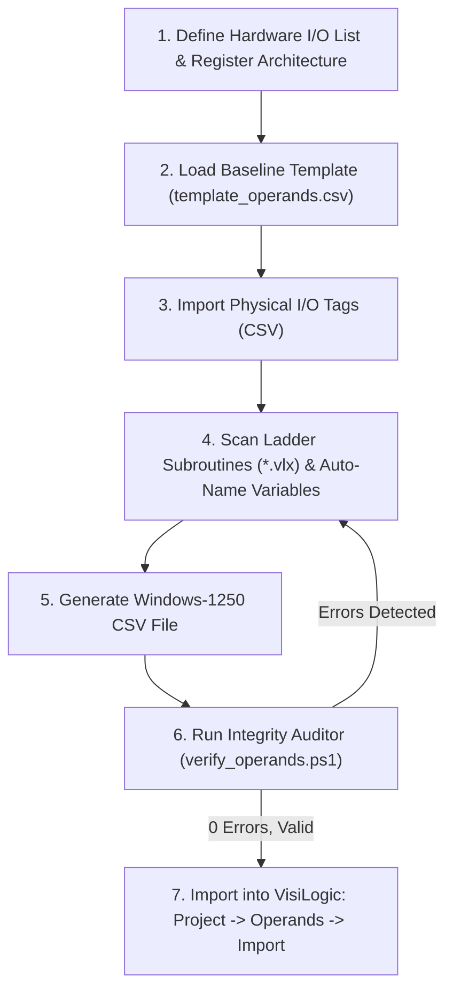

# VisiLogic Operands Database Generator (Operands CSV Generator AIO)
### Complete All-In-One Toolkit for Generating, Merging, and Validating `operands.csv` Databases for Unitronics Vision Series PLCs (V130, V350, V570, V1040, V1210)

---

## 1. Introduction and Architecture (AIO)

The **Operands CSV Generator AIO** is an integrated automation framework for managing process variables, analog registers, hardware I/O mapping, and system diagnostic tags for **Unitronics VisiLogic**. Designed according to the **All-In-One (AIO)** standard, it operates autonomously for control systems engineers and automated AI workflows.

In VisiLogic, manually entering hundreds of variable descriptions, auxiliary flags, timers, and PID setpoints across multiple memory banks is time-consuming and prone to typos or synchronization mismatches with ladder subroutines (`*.vlx`). This package provides an automated solution:
- Enforces **100% compliance with VisiLogic's CSV import specification** (18 columns, exactly 8,192 address rows, Windows-1250 / ANSI encoding).
- Safeguards native factory system tags (`SB`, `SI`, `SL`, `SDW`).
- Ingests and maps physical I/O signal lists from structured CSV files.
- **Scans compiled ladder logic subroutines (`*.vlx`)** via Microsoft Jet 4.0 OLEDB to identify referenced operands, verifying that 100% of variables used in the PLC program are symbolically documented.

### Package Directory Layout:

```text
operands-generator/
├── templates/
│   └── template_operands.csv       # Standard 8192-row baseline with intact Unitronics SB/SI/SL/SDW descriptions
├── OperandsBuilder.ps1             # OOP generator engine (OperandsBuilder class)
├── generate_operands.ps1           # CLI interface with automatic 32-bit SysWOW64 elevation
├── verify_operands.ps1             # Structural CSV validator and *.vlx coverage auditor
├── example_demo_operands.ps1       # Demonstration script building sample variable databases
├── DEMO_OPERANDS.csv               # Pre-compiled verified demo operands file
└── README.md                       # Technical manual, reverse engineering chronicle, and API reference
```

### Core Components:
1. **`OperandsBuilder.ps1`**: The OOP core engine. Manages template ingestion, CSV merging, I/O mapping from external tables, text sanitization (stripping newlines, replacing commas with `|`, truncating to 50 characters), scanning binary Jet OLEDB tables in `*.vlx` files, and emitting CP1250 CSV streams.
2. **`generate_operands.ps1`**: Universal CLI interface. Takes template, input CSVs, and subroutine directories as arguments, providing `-AutoNameMissing` to label undeclared operands automatically.
3. **`verify_operands.ps1`**: Automated auditor. Checks line counts (exactly 8,193 lines), 18-column header conformity, character length constraints, duplicate symbol detection, and ladder subroutine variable coverage.
4. **`templates/template_operands.csv`**: Reference baseline containing full factory descriptions for all Unitronics system registers with an unassigned user memory space.

---

## 2. Engineering Chronicle: Technical Requirements of the VisiLogic CSV Importer

### 2.1. Exact Row Count Constraint (8,192 Data Rows)
VisiLogic's operand database manager does not accept partial CSV files containing only defined variables. The memory architecture for Vision controllers allocates an address space of $0 \dots 8191$ for every memory type.
- The CSV file **must contain exactly 8,193 lines** (1 header line + 8,192 address rows from `0` to `8191`).
- Missing even a single row causes VisiLogic to reject the entire file with an import error.

### 2.2. Column Structure and the "Trailing Comma" Quirk
The header requires exactly 18 columns in a fixed sequence:
```csv
Address,MB,MI,MF,ML,MDW,SB,SI,SL,SDW,I,O,T,C,XB,XI,XL,XDW
```
Inspection of native VisiLogic exports revealed that every data line terminates with a trailing comma:
```csv
0,,,,,,SB 0 - Always OFF,,,,,,,,,,,,
```
A row with 18 fields contains 18 commas, resulting in a 19th empty element when split by standard delimiter functions. Parsers that do not anticipate this quirk flag false column-count mismatches.

### 2.3. Character Encoding (Windows-1250 / ANSI vs UTF-8)
Saving the CSV in UTF-8 (or UTF-8 with BOM) causes localized characters and engineering symbols to display as garbled mojibake (e.g. `°C`, `µS`, or replacement diamonds `?`).
- VisiLogic is a 32-bit legacy Win32 application that does not decode UTF-8 in its operand database.
- It expects single-byte ANSI encoding matching the regional Windows locale (**Windows-1250 / CP1250** for Central and Eastern Europe).
- `OperandsBuilder.ps1` forces stream writes using `[System.Text.Encoding]::GetEncoding(1250)`.

### 2.4. Comma Escaping in Variable Names and System Descriptions
VisiLogic's CSV parser does not support standard quote-escaping (e.g. `"Text, with comma"`). Every comma `,` encountered in a field is unconditionally parsed as a column delimiter!
For example, factory Unitronics system integer descriptions often contain text like:
`Scan Time, Resolution: Units of 1 mSec`
Leaving this comma unescaped shifts subsequent descriptions one column to the right, placing `Units of 1 mSec` into the `SL` column and corrupting database alignment.
- **Resolution**: `OperandsBuilder.ps1` automatically sanitizes text, substituting commas with a vertical pipe `|` (e.g. `Scan Time| Resolution: Units of 1 mSec`), preserving readability while protecting CSV column integrity.

### 2.5. Detecting "Orphan" Operands in Ladder Subroutines
When developing ladder logic (`*.vlx`), engineers or automated AI agents reference internal registers (scaling buffers, communication handshakes, sequencer step pointers) that may lack entries in the operand descriptions table. In VisiLogic, these appear as anonymous addresses (e.g. `MI 210` instead of `Target_Speed_RPM`).
- `OperandsBuilder.ps1` connects directly to the Microsoft Jet 4.0 database inside `*.vlx` files.
- It queries the `expimp_LdrElmsOprs` table, extracts all referenced operands, compares them against the database, and:
  1. Reports missing descriptions,
  2. Automatically assigns structured engineering tags (e.g. `Var_MI_210`) when invoked with `-AutoNameMissing`.

---

## 3. Troubleshooting & Diagnostics Reference

| # | Symptom in VisiLogic / PowerShell | Root Cause | Consequence | Resolution |
|:---:|:---|:---|:---|:---|
| **1** | **"Invalid CSV format"** or shifted columns on import. | Variable description contained raw commas `,` or newline characters. | Data shifts rightward (e.g. input labels placed on outputs). | Sanitize with `OperandsBuilder.ps1`; commas become `|`. |
| **2** | **Garbled characters / mojibake** in VisiLogic. | File saved in UTF-8 instead of Windows-1250 (ANSI). | Illegible symbols on HMI displays and watch tables. | Save strictly using CP1250 encoding. |
| **3** | **Description truncated** in VisiLogic dialogs. | Description exceeded the 50-character limit. | Label clipped; loss of technical context. | `OperandsBuilder` truncates at 50 chars; use concise engineering names. |
| **4** | **Duplicate symbol names** for the same operand type. | Same tag assigned to multiple distinct addresses. | Ambiguous cross-referencing in ladder editor. | `verify_operands.ps1` highlights duplicates as warnings. |
| **5** | PowerShell error: `Microsoft.Jet.OLEDB.4.0 provider is not registered`. | Running in 64-bit PowerShell; Jet 4.0 is 32-bit only. | Cannot scan `.vlx` files for operand usage. | Auto-elevate to 32-bit `SysWOW64\powershell.exe`. |
| **6** | Import error: **"File is incomplete"**. | CSV contains fewer than 8,193 lines (e.g. empty rows truncated). | VisiLogic rejects import; full address range required. | Always generate using baseline `template_operands.csv` (8,192 rows). |

---

## 4. Step-by-Step Generation and Import Procedure



### Step 1: Generating the Database via CLI
```powershell
powershell -ExecutionPolicy Bypass -File .\generate_operands.ps1 `
    -OutputPath ".\Application_Operands.csv" `
    -TemplatePath ".\templates\template_operands.csv" `
    -InputCsv ".\base_operands.csv" `
    -IoCsv ".\hardware_io_map.csv" `
    -VlxDir "..\subroutines\" `
    -AutoNameMissing
```

### Step 2: Verifying File Integrity
```powershell
powershell -ExecutionPolicy Bypass -File .\verify_operands.ps1 -CsvPath ".\Application_Operands.csv"
```

*Expected Verification Output:*
```text
[OK] Row count: 8193 (full address space 0..8191)
[OK] Header matches VisiLogic 18-column specification
[OK] All rows contain valid column delimiter count (18)
[OK] No user descriptions exceed 50-character limit
[OK] No duplicate symbol names in user memory space
[OK] All operands referenced in *.vlx subroutines have descriptive tags!
[SUCCESS] CSV file is 100% valid and ready for VisiLogic import!
```

### Step 3: Importing into VisiLogic
1. Launch **Unitronics VisiLogic** and open your project (`.vlp`).
2. In the menu bar, navigate to: **Project** > **Operands** > **Import from CSV**.
3. Select the verified `.csv` file.
4. Confirm the prompt to overwrite operand descriptions.
5. Open the **Operand Descriptions** table (`Ctrl+D`) to view the synchronized tags.

---

## 5. Guidelines for AI Agents (Prompting & Automation Rules)

When generating or extending operands databases:
1. **Never generate the CSV from scratch using raw string concatenation.** Always load `templates/template_operands.csv` through `[OperandsBuilder]::new()`. This preserves native Unitronics diagnostic tags (`SB`, `SI`, `SL`, `SDW`).
2. **Strictly enforce Windows-1250 encoding.** Writing UTF-8 will corrupt localized text in VisiLogic.
3. **Never include unescaped commas in tag descriptions.** Use underscores `_` or pipes `|`.
4. **Adhere to the 50-character length boundary.**
5. **Always verify via `verify_operands.ps1`** prior to signaling task completion.

---

## 6. Technical Specifications & Memory Banks Matrix

| Column | Type | Name | Data Width | Address Range | Purpose |
|:---:|:---:|:---|:---:|:---:|:---|
| **Address** | - | Address Index | - | `0 .. 8191` | Row memory index |
| **MB** | Bit | Memory Bit | 1 bit | `0 .. 8191` | User flags, sequencer steps, pushbuttons |
| **MI** | Integer | Memory Integer | 16-bit (Signed) | `0 .. 8191` | Process values, analog scaling, setpoints |
| **MF** | Float | Memory Float | 32-bit (IEEE 754) | `0 .. 8191` | Floating point variables |
| **ML** | Long | Memory Long | 32-bit (Signed) | `0 .. 8191` | 32-bit counters, elapsed process timers |
| **MDW** | DWord | Memory Double Word | 32-bit (Unsigned) | `0 .. 8191` | Bitmasks, high-speed counters, hash keys |
| **SB** | Bit | System Bit | 1 bit | `0 .. 8191` | Unitronics system flags (SB 0 = Always OFF, SB 1 = Always ON) |
| **SI** | Integer | System Integer | 16-bit | `0 .. 8191` | System registers (Scan Time, COM status, RTC) |
| **SL** | Long | System Long | 32-bit | `0 .. 8191` | 32-bit system registers |
| **SDW** | DWord | System Double Word | 32-bit | `0 .. 8191` | System double words (network statistics) |
| **I** | Bit | Digital Input | 1 bit | `0 .. 8191` | Physical digital inputs (CPU & expansion) |
| **O** | Bit | Digital Output | 1 bit | `0 .. 8191` | Physical relay / transistor outputs |
| **T** | Timer | Hardware Timer | Struct (32-bit) | `0 .. 8191` | Hardware timers (preset, current, status bit) |
| **C** | Counter | Hardware Counter | 16-bit | `0 .. 8191` | Hardware counters |
| **XB** | Bit | Extended Bit | 1 bit | `0 .. 8191` | Extended bit memory |
| **XI** | Integer | Extended Integer | 16-bit | `0 .. 8191` | Extended 16-bit memory |
| **XL** | Long | Extended Long | 32-bit | `0 .. 8191` | Extended 32-bit memory |
| **XDW** | DWord | Extended Double Word| 32-bit | `0 .. 8191` | Extended double words |
