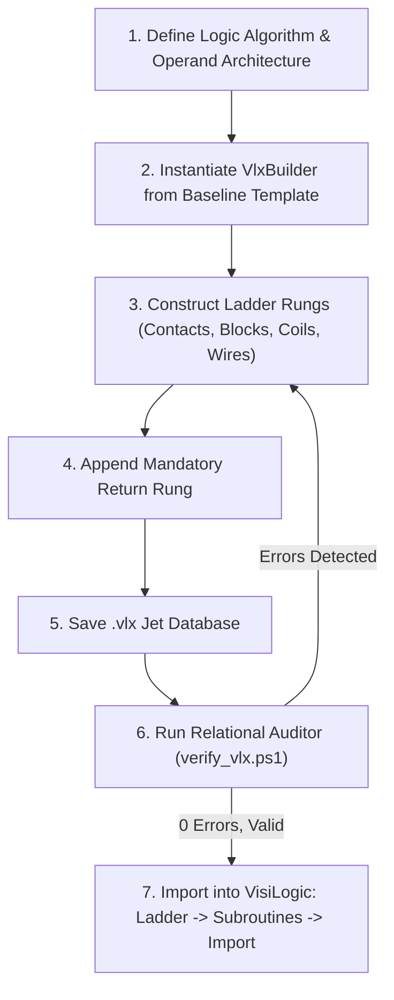

# VisiLogic Ladder Subroutine Generator (VLX Generator AIO)
### Complete All-In-One Toolkit for Generating, Wiring, and Validating `*.vlx` Subroutines for Unitronics Vision Series PLCs (V130, V350, V570, V1040, V1210)

---

## 1. Introduction and Architecture (AIO)

The **VLX Generator AIO** is an integrated automation framework for programmatically generating, wiring, and validating ladder logic subroutines (Ladder Logic Subroutines) for **Unitronics VisiLogic**. Designed according to the **All-In-One (AIO)** standard, it functions autonomously for control systems engineers and automated AI agents.

This toolkit eliminates manual drag-and-drop ladder construction in the VisiLogic GUI, generating syntactically valid, geometrically aligned, and relationally verified `*.vlx` files in seconds.

### Package Directory Layout:

```text
subroutine-generator/
├── templates/
│   └── template.vlx          # Standard Jet 4.0 database template with empty ladder schema
├── VlxBuilder.ps1             # OOP generator engine (classes VlxBuilder, VlxOpcodes, VlxOperandTypes)
├── generate_subroutine.ps1    # CLI interface with automatic 32-bit SysWOW64 elevation
├── verify_vlx.ps1             # Relational integrity and grid geometry validator
├── example_demo.ps1           # Demonstration script building sample ladder rungs
├── CREATION_AND_LINKING_RULES.md # 80x60 grid geometry, wiring, and coil placement rules
├── ELEMENTS_LIBRARY.md        # Complete opcodes matrix (contacts, coils, math, compare, timers)
└── README.md                  # Technical manual, reverse engineering chronicle, and API reference
```

### Core Components:
1. **`VlxBuilder.ps1`**: The OOP core engine. Manages OLEDB transactions, assigns primary/foreign keys, calculates $80 \times 60$ grid coordinates, routes signal wires, and maps operands and constants.
2. **`generate_subroutine.ps1`**: Universal CLI interface. Inspects process bitness and automatically relaunches in the 32-bit `SysWOW64` subsystem required by the `Microsoft.Jet.OLEDB.4.0` driver.
3. **`verify_vlx.ps1`**: Automated auditor. Inspects database relationships, asserts presence of the mandatory `Return` rung, checks for NULL fields that crash VisiLogic, and validates coordinate continuity.
4. **`templates/template.vlx`**: Canonical baseline Access 97 / Jet 4.0 database secured with the standard Unitronics system password.

---

## 2. Engineering Chronicle: Reverse Engineering the `.vlx` Binary Format

### 2.1. Container Identification
VisiLogic exports and imports ladder subroutines using `.vlx` (*VisiLogic Subroutine Export*) files. Hexadecimal inspection revealed the `Standard Jet DB` signature at offset 0x00:
```text
00000000: 00 01 00 00 53 74 61 6e 64 61 72 64 20 4a 65 74  ....Standard Jet
00000010: 20 44 42 00 01 00 00 00 00 00 00 00 00 00 00 00   DB.............
```
This proved that `.vlx` files are relational databases conforming to the **Microsoft Access 97 / Jet 4.0** format.

### 2.2. Authentication and Database Password
Direct connection attempts via standard OLEDB drivers initially failed with: *Not a valid password*. Memory string analysis of the VisiLogic compiler binaries revealed the universal database password:
```text
Password: UniOpenSesame
Provider: Microsoft.Jet.OLEDB.4.0
```
OLEDB connection string for programmatic querying:
```powershell
"Provider=Microsoft.Jet.OLEDB.4.0;Data Source=$Path;Jet OLEDB:Database Password=UniOpenSesame;"
```

### 2.3. Schema and Relational Hierarchy
A valid `.vlx` database organizes ladder logic through tables prefixed with `expimp_`:
1. **`expimp_Subroutine`**: Subroutine header metadata (Subroutine Name, unique ID, Project ID).
2. **`expimp_LdrStrip`**: Defines ladder rungs (Strips). Each rung specifies its vertical sequence (`OrderNum`) and pixel height (default: 14).
3. **`expimp_LdrElements`**: Physical ladder elements placed on the rung (contacts, function blocks, coils, wires) with grid coordinates ($Xs, Ys, Dx, Dy$).
4. **`expimp_LdrElmsOprs`**: Maps elements to PLC operands (`MB`, `MI`, `DW`, `T`) or constant literals.
5. **`expimp_LdrComments`**: Optional rung documentation headers.

---

## 3. Discrete Grid Geometry & The Iron Rules of Ladder Construction

The VisiLogic ladder editor operates on an internal coordinate grid:
- **Horizontal Axis ($X$):** $0 \dots 80$. Left power rail is at $X = 0$; right power rail terminates at $X = 80$.
- **Vertical Axis ($Y$):** $0 \dots 60$. Standard rung height is 14 units (`Height = 14`).

```text
X=0                                                                     X=74      X=80
 |                                                                        |        |
 |--[ NO Contact ]------[ Compare Block ]------[ Math ADD ]---------------( Coil )--|
 |   (Xs=0, Xe=6)        (Xs=10, Xe=23)         (Xs=28, Xe=41)          (Xs=74,Xe=80)
 |
 Ys=4 ----------------- Main Power Flow Rail -------------------------------------- Ys=4
```

### Rule 1: The Main Signal Rail Axis ($Ys = 4$)
All contacts and block enable (`EN`) inputs on the primary rung path **must be placed strictly at $Ys = 4$**. Placing elements at other coordinates causes jagged rungs, disconnected terminals, and logic evaluation failures.

### Rule 2: Coil Placement ($Xs = 74, Xe = 80$)
All coils (Direct, Inverted, Set, Reset, Toggle) and Timer coils **must terminate against the right power rail at $Xs = 74$**. Placing a coil mid-rung is a syntax violation in VisiLogic.

### Rule 3: Continuous Horizontal Wiring (Opcode 100)
Any unoccupied space between the output of an element ($Xe_A$) and the input of the next element ($Xs_B$) must be closed with a horizontal wire (`AddWire` with $Dx = Xs_B - Xe_A$ at $Ys = 4$). The segment from the last block to the coil at $Xs = 74$ must always be bridged.

### Rule 4: Mandatory Return Rung
Every subroutine must terminate with a dedicated final rung containing a single horizontal wire across the grid ($Xs=0$ to $Xs=74$) and no coil. Omitting this causes execution overflow in the PLC ladder scanner.

---

## 4. Troubleshooting & Diagnostics Reference

| # | Symptom in VisiLogic / PowerShell | Root Cause | Consequence | Resolution |
|:---:|:---|:---|:---|:---|
| **1** | Broken or jagged rungs with disconnected pins. | Elements placed at irregular $Ys$ coordinates (e.g. $Ys=0$ or $Ys=10$). | Power flow interrupted; logic fails to execute. | Place all primary rung elements strictly at $Ys = 4$. |
| **2** | Compilation error: **"Coil must be at right rail"**. | Coil placed mid-rung ($Xs < 74$). | VisiLogic compiler rejects ladder program. | Place coils at $Xs = 74$ ($Xe = 80$). Bridge gaps with horizontal wires. |
| **3** | PLC execution freeze or subroutine loop fault. | Subroutine lacks a terminating `Return` rung. | Scanner fails to return to Main routine. | Always ensure the last rung is a clean return strip. |
| **4** | PowerShell error: `Microsoft.Jet.OLEDB.4.0 provider is not registered`. | Executed in 64-bit PowerShell; Jet 4.0 is 32-bit only. | Database connection fails. | Execute using 32-bit PowerShell (`SysWOW64\powershell.exe`). |
| **5** | VisiLogic crash with memory violation upon import. | Record in `expimp_LdrElements` has NULL in required fields. | Deserializer encounters invalid memory pointer. | `verify_vlx.ps1` validates that no NULL keys exist. |

---

## 5. Step-by-Step Generation and Import Procedure



### Step 1: Programmatic Construction via PowerShell OOP API
```powershell
. .\VlxBuilder.ps1

$builder = [VlxBuilder]::new(".\templates\template.vlx")
$builder.SetSubroutineName("Lead_Lag_Pumps")

# Rung 1: Lead Pump Run Command
$strip1 = $builder.AddStrip("Lead Pump Control")
$builder.AddContact($strip1, 0, 4, [VlxOpcodes]::DirectContact, [VlxOperandTypes]::MB, 10)  # Start Request
$builder.AddContact($strip1, 6, 4, [VlxOpcodes]::InvertedContact, [VlxOperandTypes]::MB, 11) # Trip Interlock
$builder.AddWire($strip1, 12, 4, 62, 0, $false)                                             # Bridge to coil
$builder.AddCoil($strip1, 74, 4, [VlxOpcodes]::DirectCoil, [VlxOperandTypes]::O, 1)          # Lead Pump Contactor

# Terminating Return Rung
$retStrip = $builder.AddStrip("Return")
$builder.AddWire($retStrip, 0, 4, 74, 0, $false)

$builder.Save(".\Pump_Control.vlx")
```

### Step 2: Verifying Subroutine Integrity
```powershell
powershell -ExecutionPolicy Bypass -File .\verify_vlx.ps1 -VlxPath ".\Pump_Control.vlx"
```

*Expected Verification Output:*
```text
============================================================
 VISILOGIC SUBROUTINE (VLX) INTEGRITY AUDIT
 File: ...\Pump_Control.vlx
============================================================
  [OK] Valid Jet 4.0 database; authenticated with UniOpenSesame
  [OK] Subroutine Name: 'Lead_Lag_Pumps'
  [OK] Rungs found: 2
  [OK] All primary elements aligned on Ys = 4 axis
  [OK] Coils placed at Xs = 74 terminating at right rail
  [OK] Mandatory Return strip validated
  [OK] 0 NULL references in relational tables
============================================================
 [SUCCESS] Subroutine is 100% valid and ready for VisiLogic import!
```

### Step 3: Importing into VisiLogic
1. Launch **Unitronics VisiLogic** and open your project (`.vlp`).
2. In the navigation tree on the left, expand **Ladder**.
3. Right-click on **Subroutines** and select **Import Subroutine**.
4. Select the verified `.vlx` file.
5. VisiLogic integrates the subroutine with all rungs, contacts, coils, and wires intact.

---

## 6. Guidelines for AI Agents (Prompting & Automation Rules)

When developing ladder subroutines with autonomous agents:
1. **Never edit `.vlx` files directly with binary string editors.** Always use `[VlxBuilder]::new()`.
2. **Enforce the $Ys = 4$ alignment rule.** All horizontal contacts, math blocks, and comparator inputs must be set to $Ys = 4$.
3. **Always terminate coils at $Xs = 74$.** Bridge intermediate gaps with Opcode 100 horizontal wires.
4. **Always include the terminating `Return` rung.**
5. **Always execute `verify_vlx.ps1` before reporting completion.**
